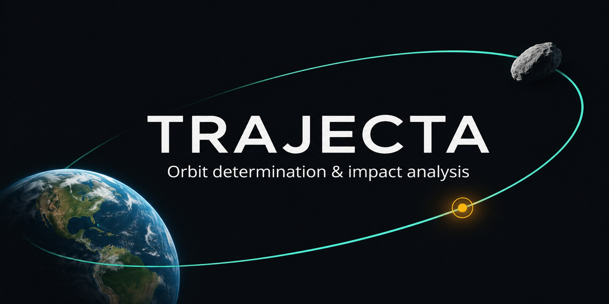
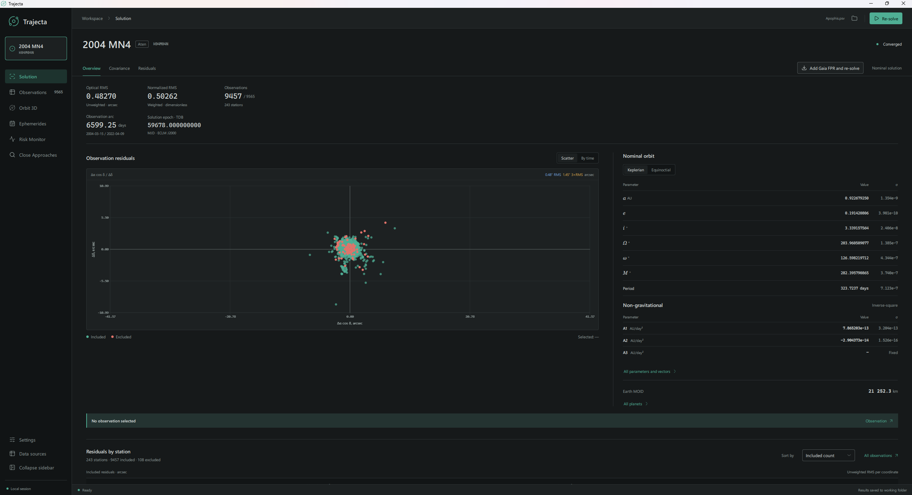
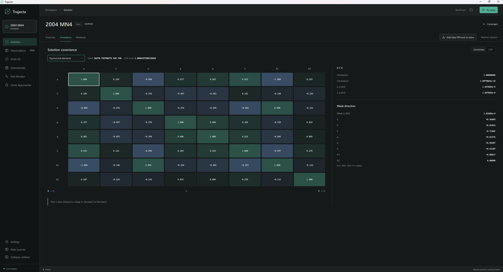
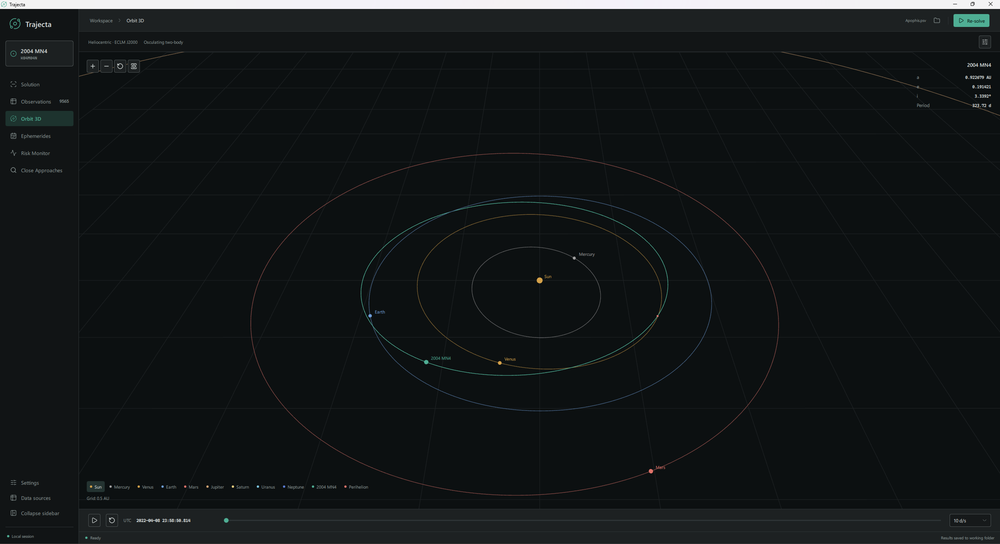
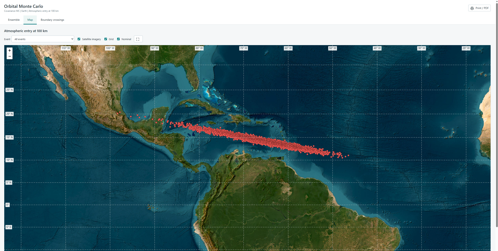
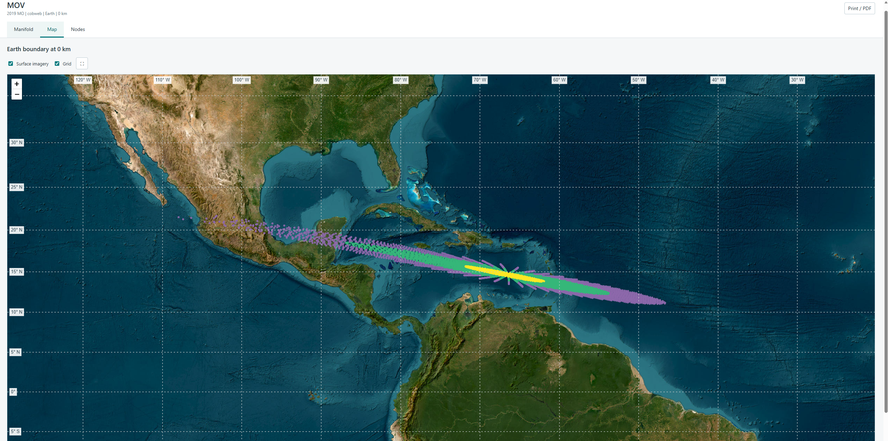
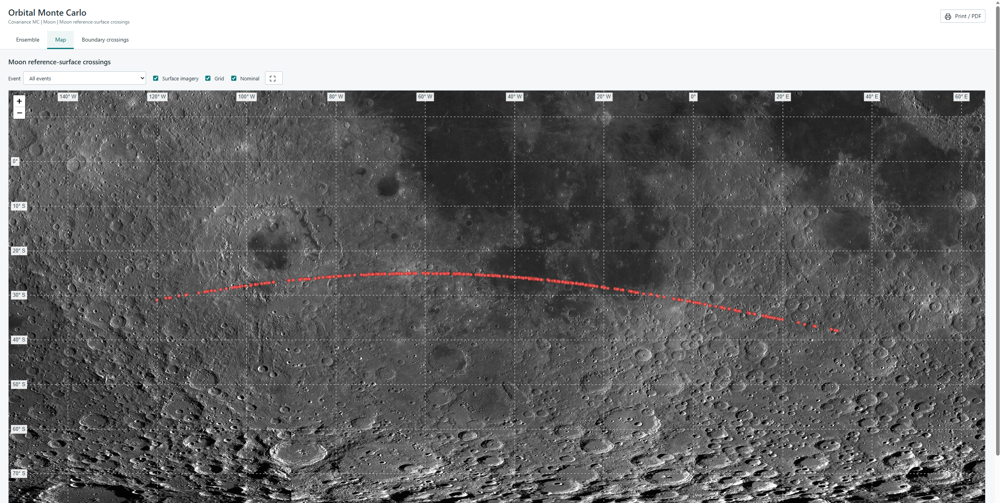

# Trajecta

Trajecta is a desktop application for determining the orbits of asteroids and
comets and exploring close approaches and impact scenarios. It combines orbit
fitting, uncertainty analysis, ephemerides, covariance and observation Monte
Carlo, the Manifold of Variations (MOV), and atmospheric Monte Carlo in one
workspace.

The aim is to make serious orbit determination and impact analysis accessible
through an intuitive, interactive workspace. Trajecta draws inspiration from
established tools such as Find_Orb and OrbFit, as well as the methods they use.

Trajecta is in active development and testing. If you encounter a bug or
unexpected behavior, please [open an issue](https://github.com/dtereshchenko-dev/Trajecta/issues)
with the steps to reproduce it.

**Downloads:** The Windows installer is available on
[GitHub Releases](https://github.com/dtereshchenko-dev/Trajecta/releases).
For a source build, see the [developer guide](DEVELOPMENT.md#build).

## Key features

- Import MPC 80-column and ADES XML/PSV observations, with optional Gaia FPR data.
- Determine and refine orbits with observation weighting, debiasing and
  configurable non-gravitational models.
- Inspect residuals and covariance, visualize orbits and generate ephemerides.
- Search for close approaches to planets and the Moon, with configurable
  reporting distances.
- Explore boundary crossings with covariance and observation Monte Carlo or
  the Manifold of Variations (MOV).
- Model atmospheric entry, fragmentation and dark flight with atmospheric Monte Carlo.

## Getting started

1. Install Trajecta and open an MPC or ADES observation file.
2. Review the calculation settings and select **Solve**.
3. Inspect the solution, residuals and covariance; generate ephemerides or
   close approaches.
4. Use Risk Monitor for a suitable solution and review the resulting reports.

Calculation settings and runtime data availability are accessible under
**Settings** and **Data sources**.

## Orbit determination

Load observations in MPC 80-column or ADES XML/PSV format, determine and refine
an orbit, and inspect the solution, observation residuals and fitted
non-gravitational parameters.

For numbered asteroids, Gaia FPR observations can be downloaded from the Gaia
Archive and included in a new fit.

Explore the fitted covariance and correlations between orbital and estimated
non-gravitational parameters.

## Orbit visualization and ephemerides

View an object's osculating orbit alongside the planets, generate ephemerides
and search for close approaches.

## Impact analysis

The Risk Monitor supports covariance Monte Carlo, observation Monte Carlo and
the Manifold of Variations (MOV). Results can be inspected in the application
and in interactive HTML reports.

Both orbital Monte Carlo modes support non-gravitational models. Covariance MC
samples the orbital state and fitted non-gravitational parameters together,
including their correlations; observation MC refits the configured parameters
for each perturbed observation set. MOV currently uses gravity-only dynamics.

Covariance MC and MOV can map atmospheric boundary crossings, as in these
simulations of the historical impactor 2019 MO:

These maps show simulated boundary crossings, not meteorites on the ground.
Earth imagery: Esri, Vantor, Earthstar Geographics, GIS User Community.

Orbital Monte Carlo can also show simulated crossings on the Moon, as in this
example for 2024 YR4:

Lunar imagery: LRO WAC mosaic, NASA / GSFC / ASU / USGS.

## Atmospheric entry

Atmospheric Monte Carlo uses StrewnField to model Earth entry, fragmentation,
ablation and dark flight. It produces numerical archives, GIS exports and
interactive reports.

## Numerical model

The dynamics include the Sun, planets, Moon and Pluto, with planetary positions
from DE440 and optional perturbations from the SB441-N16 asteroid ephemeris.
They include EIH relativistic corrections, solar J2 and Earth J2/J3/J4 near
Earth, with a time-dependent Earth pole when orientation data are available.
RA15 and IAS15 integrators and non-gravitational models are available.

## Limitations and development status

- MOV currently uses gravity-only RA15 dynamics for ground-based optical
  observations; observation arcs and prediction horizons are limited to 30 days.
- LOV tracing and virtual-impactor refinement are under development in the core
  and are not available as a Risk Monitor UI mode.
- Atmospheric simulation results are conditional on the supplied entry states;
  they are not a new estimate of orbital impact probability.

For confirmed bugs or unexpected behavior, see or open a
[GitHub issue](https://github.com/dtereshchenko-dev/Trajecta/issues).

## For developers

The [developer guide](DEVELOPMENT.md) covers the project structure, C++ API,
impact-monitoring interfaces, dependencies, runtime data, building and tests.

## Sub-project docs

- [TrajectaCLI](TrajectaCLI/README.md) — build and usage.
- [StrewnField](StrewnField/README.md) — atmospheric jobs, physics and reports.
- MC archive reference: [EN](data/docs/strewn/mc-archive-reference-en.html),
  [RU](data/docs/strewn/mc-archive-reference-ru.html).

## License

See [GPL-3.0-or-later](LICENSE) and the project notice in
[`TrajectaUI/LICENSE`](TrajectaUI/LICENSE). Third-party
attributions in [`TrajectaUI/THIRD_PARTY.md`](TrajectaUI/THIRD_PARTY.md).
