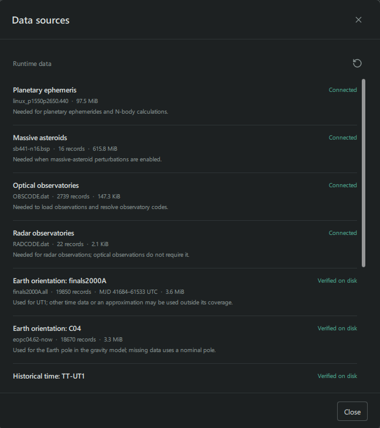
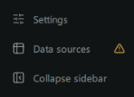
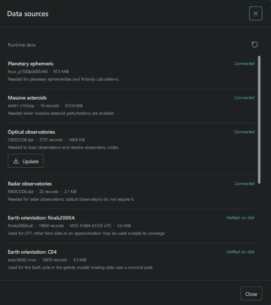

Select **Data sources** in the sidebar to see the datasets available to
Trajecta. Each entry shows its status and, where available, its file name,
record count and date coverage. The data needed for a calculation depend on
the observations and settings you choose.

## Ephemerides and observatories

| Source | Used for |
| --- | --- |
| Planetary ephemeris: DE440 | Planetary positions, observer geometry and N-body calculations. |
| Massive asteroids: SB441-N16 | Perturbations from 16 massive asteroids, when enabled in the force model. |
| Optical observatories | Resolving observatory codes and locations in optical observations. |
| Radar observatories | Station information for radar observations. Optical observations do not require this catalogue. |

DE440 and the observatory catalogues are included with the installer. SB441-N16
is optional and can be downloaded from **Data sources**. Enable its
perturbations in the calculation settings when you want to use it.

## Earth orientation and observation corrections

| Source | Used for |
| --- | --- |
| Earth orientation: finals2000A | UT1 information for time and Earth-orientation calculations. |
| Earth orientation: C04 | Earth-pole orientation in the gravity model. |
| Historical time: TT-UT1 | Historical time conversion when finals2000A does not cover the epoch. |
| Astrometric weights: VFCC17 | Observation weights when the VFCC17 scheme is selected. |
| Astrometric debias: FCCT14 and EFCC18 | Catalogue corrections when the corresponding debias model is selected. |

For epochs beyond the available C04 data, Trajecta uses extrapolated and
modelled Earth-orientation values rather than measurements. This can affect
near-Earth trajectory calculations.

When finals2000A does not cover an epoch, other time data or an approximation
may be used. If C04 data are missing, the gravity model uses a nominal pole.
Missing VFCC17 rules fall back to a weight of one arcsecond. Check the selected
weighting and debias settings as well as the source status before a fit.

## Check and update sources

The warning icon beside **Data sources** draws attention to a source that
needs checking, a pending restart or an available observatory update. Open the
dialog to see the current status.

- **Connected** means the source is loaded by the application. A file can also
  be **Verified on disk**, **Missing** or **Invalid**. Some entries report that
  a previously loaded file is no longer on disk.
- Use **Check again** to refresh source status and check the observatory
  catalogues for updates. An **Update** button appears when a catalogue update
  is available.
- Use **Download SB441** if you need massive-asteroid perturbations and the
  ephemeris is not available.
- Restart Trajecta when the dialog asks you to reload changed data. Also check
  date coverage: a connected file may not cover the epoch of your calculation.

When an observatory catalogue has an update, its **Update** button appears in
the corresponding row:

Gaia FPR observations are separate from these runtime sources. For a suitable
object, use **Add Gaia FPR and re-solve** on the solution page.

## Where files are stored

The installed application includes the correction tables and Earth-orientation
files. The planetary ephemeris and observatory catalogues are stored in the
user data directory, separately from the application binaries:

- **Windows:** `%LOCALAPPDATA%\Trajecta\Trajecta\`, in the `ephemerides` and
  `observatories` folders.
- **Linux:** `~/.local/share/Trajecta/Trajecta/` by default. If `XDG_DATA_HOME`
  is set, it replaces `~/.local/share`.

Calculation results are stored separately, in dated folders grouped by object.
On Windows, when the application directory is not writable, Trajecta uses
`%LOCALAPPDATA%\Trajecta\work`. If the application directory is writable,
results can instead be saved in its `work` folder.

On Linux, the default is `~/.local/share/Trajecta/work`, or
`$XDG_DATA_HOME/Trajecta/work` when `XDG_DATA_HOME` is set. To open the folder
for the current solution, use the folder icon in the application's top bar.
