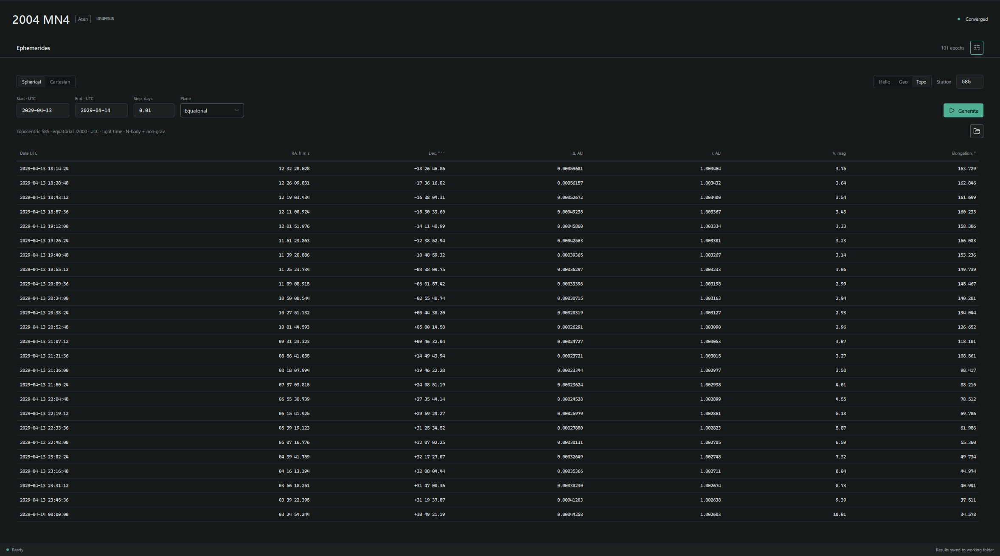
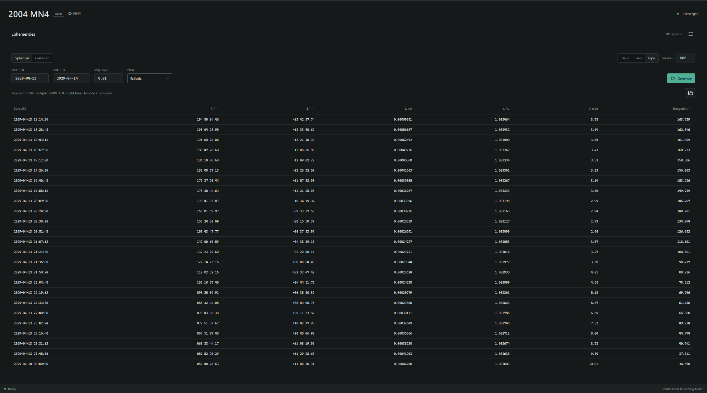
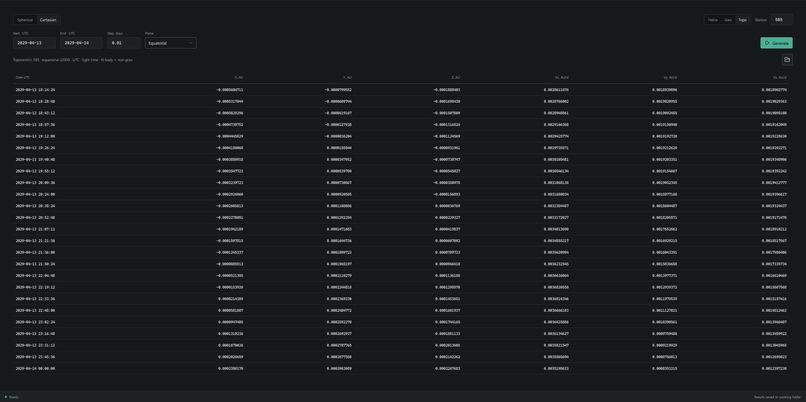
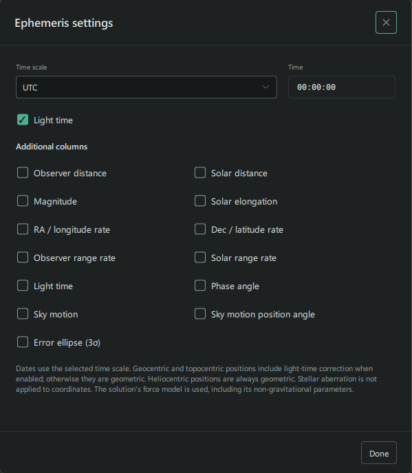
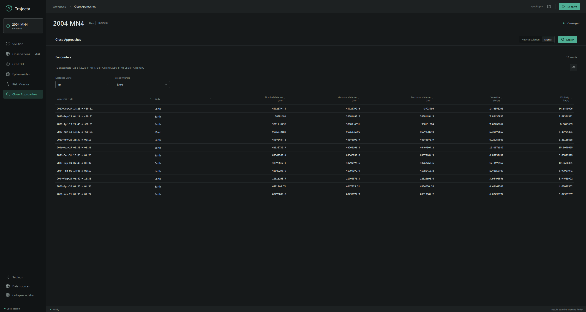

These tools use the current orbit solution. Their results depend on its epoch,
uncertainty, force model and the chosen prediction interval.

## Ephemerides

The **Ephemerides** page shows the object's position and other quantities at
the epochs you choose. It uses the current orbit solution and its force model,
including any fitted non-gravitational parameters.

### Generate an ephemeris

The example below uses Apophis during its 2029 Earth encounter:

1. Solve the orbit and open **Ephemerides**.
2. Select **Spherical**, **Topo** and the **Equatorial** plane. Enter `585`
   as the MPC station code.
3. Set the start date to `2029-04-13`, the end date to `2029-04-14` and the
   step to `0.01` days, or 14 minutes 24 seconds.
4. Open **Ephemeris settings** using the button at the upper right. Select
   **UTC**, set the time to `00:00:00` and enable **Light time**.
5. Select **Generate**. The table contains 101 epochs for this interval;
   scroll through the rows to inspect the encounter.

The line above the table records the centre, coordinate plane, time scale,
light-time setting and force model used for the calculation. The values in
your table depend on the orbit solution and settings used.

### Centre and coordinates

Choose where the position is measured from:

| Centre | Description |
| --- | --- |
| **Helio** | The Sun. |
| **Geo** | The centre of the Earth. |
| **Topo** | An observatory identified by its MPC station code. |

In **Spherical** mode, the **Equatorial** plane displays right ascension and
declination. The **Ecliptic** plane displays ecliptic longitude `λ` and
latitude `β`. Both use the J2000 reference plane. Change the plane and
generate the ephemeris again to inspect the other coordinates.

**Cartesian** displays position `X`, `Y`, `Z` in AU and velocity `Vx`, `Vy`,
`Vz` in AU/day, relative to the selected centre and in the selected plane.
With light time enabled, Cartesian velocities account for the changing emission
time. They should not be confused with the radial relative velocity reported
in the range-rate column.

### Time and light time

In **Ephemeris settings**, choose UTC, TT or TDB for the dates and enter the
time of the first epoch. The date fields and results use the selected scale.

With **Light time** enabled, geocentric and topocentric positions account
for the travel time of light from the object. With it disabled, those
positions are geometric. Heliocentric positions are always geometric.
Stellar aberration is not applied to the displayed coordinates.

### Additional columns

Use the checkboxes in **Ephemeris settings** to choose the quantities shown
alongside the coordinates. The available columns include observer and solar
distance, magnitude, solar elongation, angular rates, range rates, light time,
phase angle and sky motion. Scroll the table horizontally when needed.

**Error ellipse (3σ)** adds the major and minor axes and orientation of the
linearized sky-plane uncertainty ellipse. It uses the propagated solution
covariance; the page reports when uncertainty could not be calculated.

For the exact output conventions, see the metadata in the saved files. In
particular, range rates are radial relative velocities; with light time
enabled, they are not derivatives of the light-time-corrected ranges.

### Saved results

Completed calculations are saved automatically in an `Ephemerides` folder
under the current solution's working folder. Use the folder button beside
the table to open the saved run. Each run contains `ephemeris.txt` and
`result.json` with the calculation settings and results.

The files include the selected table columns. Calculated uncertainty values
are also included even when their columns are not displayed in the table.

## Close approaches

**Close Approaches** searches the current nominal trajectory for encounters
with the eight planets and the Moon. It uses the converged N-body solution,
including its non-gravitational model when enabled.

### Search for encounters

1. Solve the orbit and open **Close Approaches**.
2. In **New calculation**, enter the start and end of the search interval in
   UTC, or set its duration in years.
3. Choose a **Reporting distance**. **Automatic by body** uses the limits
   listed on the page. **Custom maximum** uses one distance in AU for every
   body.
4. Select **Search**. When the calculation finishes, the **Events** view
   shows the encounters found within the reporting limits.

The reporting distance filters which encounters are listed; it does not change
the force model. **Source data** shows the current solution, fit epoch,
non-gravitational model and covariance availability.

### Read the results

Each row describes a nominal encounter. The input interval is in UTC, but
the table displays encounter times in **TDB**. Where available, the value
after `±` is the local linear 3σ estimate of the time uncertainty.

| Column | Meaning |
| --- | --- |
| Date/Time (TDB) | Time of nominal closest approach, with its estimated time uncertainty when available. |
| Body | Planet or Moon involved in the encounter. |
| Nominal distance | Closest distance along the nominal trajectory, measured from the body's centre. |
| Minimum / Maximum distance | Local linear 3σ distance bounds derived from the encounter uncertainty ellipse. |
| V-relative | Relative speed at nominal closest approach. |
| V-infinity | Nominal hyperbolic excess speed, when defined. |

The distance bounds use the 3σ B-plane ellipse and nominal encounter energy;
they are not simply the nominal distance plus or minus three standard
deviations. These local linear bounds are not guaranteed distance limits or
probability intervals. Strongly nonlinear encounters require additional
uncertainty propagation. An unavailable estimate is shown as a dash.

Use **Distance units** and **Velocity units** to change the table display,
and select a column heading to sort the events. In the example above, the
table includes Apophis's 13 April 2029 encounter with Earth. Its distance is
from Earth's centre, not its surface.

### Saved results

Completed searches are saved automatically in the `CloseApproaches` folder
under the current solution's working folder. Use the folder button in
**Events** to open the run. It contains `encounters.txt` and `result.json`.

This search does not calculate impact probability. For boundary crossings
and sampling-based impact analysis, see [Impact Analysis](../impact-analysis/).
