Atmospheric Monte Carlo follows an object from an Earth entry at 100 km through
fragmentation, ablation and the flight of surviving fragments. It samples the
entry states and physical parameters you provide, then displays the simulated
ground impacts in a report.

The calculation describes what happens **given an entry**. It is separate from
the orbital probability of crossing the entry boundary.

For the equations and numerical methods, see the
[atmospheric model reference](../../reference/atmospheric-model/).

## Choose an entry source

Open **Risk Monitor**, select **New calculation**, then **Atmospheric MC**.
Choose an entry archive from an orbital run, or enter a fixed state. The
screenshot shows the form before an archive or absolute magnitude has been
selected; the calculation cannot start until the required inputs are filled in.

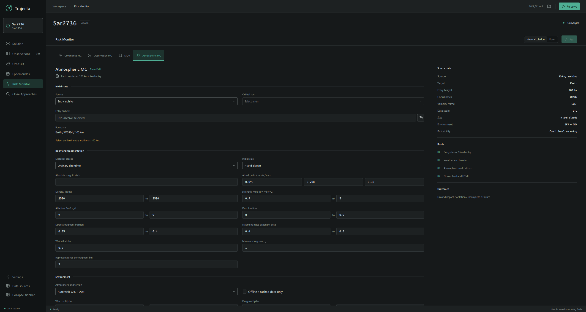

### Entry archive

1. First run [orbital Monte Carlo](../monte-carlo/) with **Earth** as the
   target and **Atmospheric entry · 100 km** as the boundary.
2. Under **Source**, choose **Entry archive**. Select a listed orbital run,
   or use the folder button to open its `result.json`.
3. If the archive contains more than one entry event, select the event to use.
   Check the entry count and other details shown on the page.

The orbital run must be complete, with no failed or cancelled trials, and
contain at least one valid crossing. Successfully propagated trajectories that
missed the boundary can be present in the archive; Atmospheric MC uses the
entry states of the selected event. A cancelled or incomplete ensemble cannot
be used. The archive must match the active Earth-orientation model and frame.
Archives produced with the former Earth-orientation model may need a new orbital
run. This compatibility check does not compare PCK file hashes: for reproducible
results, keep track of the PCK files used for both calculations.

When available, the source solution's absolute magnitude `H` is filled in
automatically. You can change it or select a different initial-size method.

### Fixed entry

Choose **Fixed entry** to supply one initial state instead of an orbital
ensemble. Enter the UTC epoch, WGS84 latitude and longitude, speed relative
to the rotating Earth in km/s, heading measured clockwise from north, and
slope measured from the local horizon. Use a negative slope for an incoming
trajectory. The state is placed at a WGS84 altitude of 100 km.

All realizations start from that same state; the atmospheric parameters are
still sampled. Use this mode to study a specified entry without sampling
orbital uncertainty.

## Body and fragmentation

Choose **Ordinary chondrite**, **Carbonaceous chondrite** or **Iron** to fill
in a set of material ranges. Editing a preset produces a custom configuration.
The preset is a starting assumption, not a determination of the object's
composition.

Under **Initial size**, choose one of:

| Method | Input |
| --- | --- |
| **H and albedo** | Absolute magnitude `H` and minimum, most likely and maximum geometric albedo. Albedo is sampled from a triangular distribution. |
| **Mass range** | Initial mass in kilograms. |
| **Diameter range** | Initial diameter in metres. |

In **H and albedo** mode, H is held fixed. The calculation samples albedo and
density, but does not independently sample uncertainty in absolute magnitude.

The remaining ranges describe the material and its breakup:

| Setting | Meaning |
| --- | --- |
| **Density** | Bulk density used to relate mass and size, in kg/m³. |
| **Strength** | Breakup threshold in MPa, using `q = ρv²`, where `v` is speed relative to the air. Check this convention when using a published strength. |
| **Ablation** | Mass-loss coefficient, in units of `10⁻⁸ kg/J`. For example, `7` means `7 × 10⁻⁸ kg/J`. |
| **Dust fraction** | Fraction of the parent mass converted to dust at breakup. |
| **Largest fragment fraction** | Fraction assigned to the largest fragment from the mass remaining after dust is removed. |
| **Fragment mass exponent beta** | Controls the power-law distribution of fragment masses. |
| **Weibull alpha** | Controls how fragment strength changes with fragment mass after breakup. |
| **Minimum fragment** | Mass cutoff for tracked fragments, in grams. |
| **Representatives per fragment bin** | Number of trajectories used to represent a grouped fragment-mass bin. Group multiplicities are retained in the results. |

The minimum and maximum values define the sampled ranges. Apart from the
triangular albedo distribution, the displayed ranges are sampled uniformly.
The entered values affect the simulated fragmentation and fall locations, so
compare them with independent measurements when those are available.

## Environment

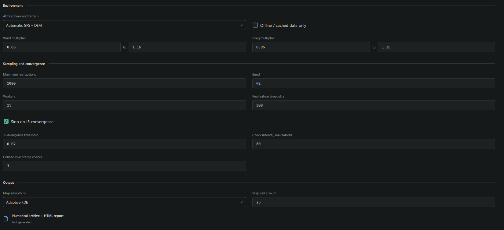

**Atmosphere and terrain** offers three sources:

- **Automatic GFS + DEM** obtains weather and elevation data for the entry.
  **Offline / cached data only** uses existing cached data and does not download
  missing files. Automatic weather requires the selected entry event to span no
  more than one hour.
- **Saved environment** uses a previously prepared environment profile.
- **Idealized atmosphere + flat ground** uses an idealized environment and a
  user-specified flat-ground height above the WGS84 ellipsoid.

**Wind multiplier** scales the wind in each realization; **Drag multiplier**
scales the drag model. They are sampled over the entered ranges. Check the
source and coverage of the environment when comparing a calculation with an
observed event.

## Sampling and convergence

Set **Maximum realizations**, **Seed** and **Workers**. The seed identifies
the random sequence; keep it together with the input, configuration and data
versions when repeating a run. **Realization timeout** limits the wall-clock
time for one realization, not the physical flight duration or the whole run.

With **Stop on JS convergence** enabled, the calculation periodically
compares successive cumulative ground-impact distributions by number and by
mass. It stops early when both Jensen–Shannon divergences remain below the
chosen threshold for the requested number of consecutive checks. **Check
interval** sets how often the comparison is made. The run can also reach the
maximum without meeting the stopping criterion.

Failed or otherwise incomplete realizations, or impacts outside the
convergence grid, prevent an early convergence declaration. Check the run
status and convergence-grid coverage if the criterion is not reached.

This check measures stability of the simulated maps under the selected inputs;
it does not establish that the material model or the weather is correct.

## Maps and results

Choose **Adaptive KDE** or **Fixed KDE** under **Map smoothing**. Fixed KDE
also exposes the kernel sigma. **Map cell size** controls the output grid;
the renderer can increase it when necessary to stay within its grid limits.

Select **Run**, then open **Runs** to inspect the status and open the report or
the run folder. Check completed, failed and incomplete realizations before
interpreting the maps. An unsuccessful realization is not evidence that no
fragments reached the ground.

## Read the report

The following screenshots show one atmospheric run for 2024 BX1. The report
contains an ensemble summary, a map, individual realizations and wind profiles.

### Ensemble

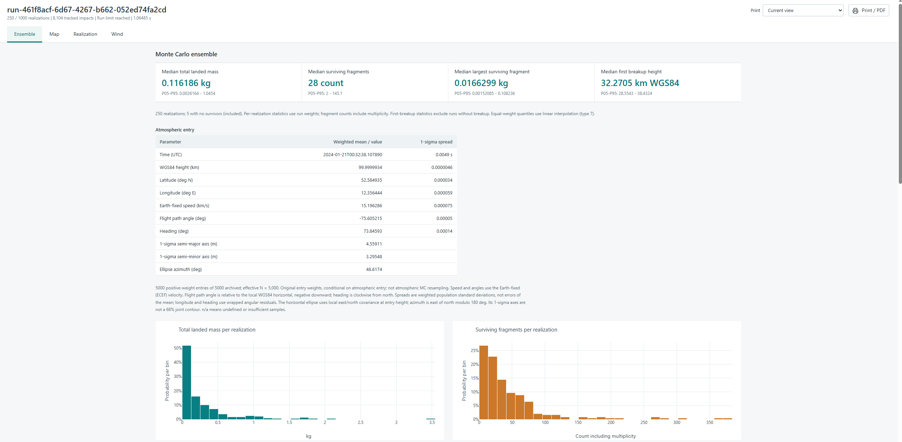

The four summary values describe the total landed mass, number of surviving
fragments, largest surviving fragment and first breakup height for a typical
realization. Each is a median; **P05–P95** shows the range between the 5th and
95th percentiles. Fragment counts include the multiplicity represented by each
tracked trajectory. Realizations without survivors contribute to the landed
mass and fragment-count statistics; realizations without breakup are excluded
from the first-breakup height statistics.

The **Atmospheric entry** table describes the original entry archive and its
weights, not just the entries sampled for the atmospheric run. It reports the
entry time, WGS84 position, Earth-fixed speed, flight direction and their
weighted spreads. The horizontal ellipse summarizes the entry-position
covariance; its 1σ axes are not a 68% joint contour.

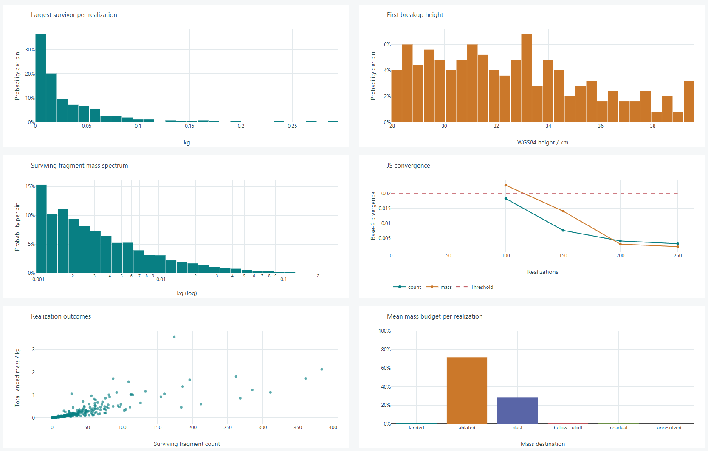

The plots show the distribution of surviving masses, first breakup heights and
other outcomes. **JS convergence** tracks changes in the cumulative impact
distributions by fragment number and mass. The dashed line is the selected
threshold. The mass budget shows how the initial mass is partitioned between
landed fragments, ablation, dust and other categories.

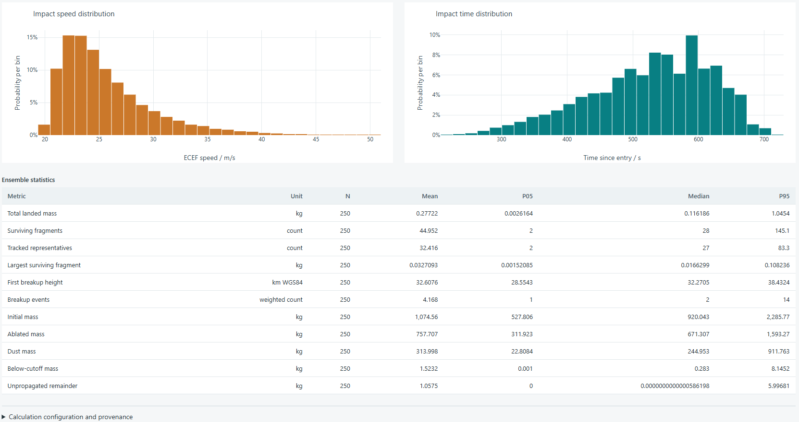

Further down, the report shows impact-speed and time distributions and a table
of ensemble statistics. Expand **Calculation configuration and provenance**
to inspect the saved settings.

### Map

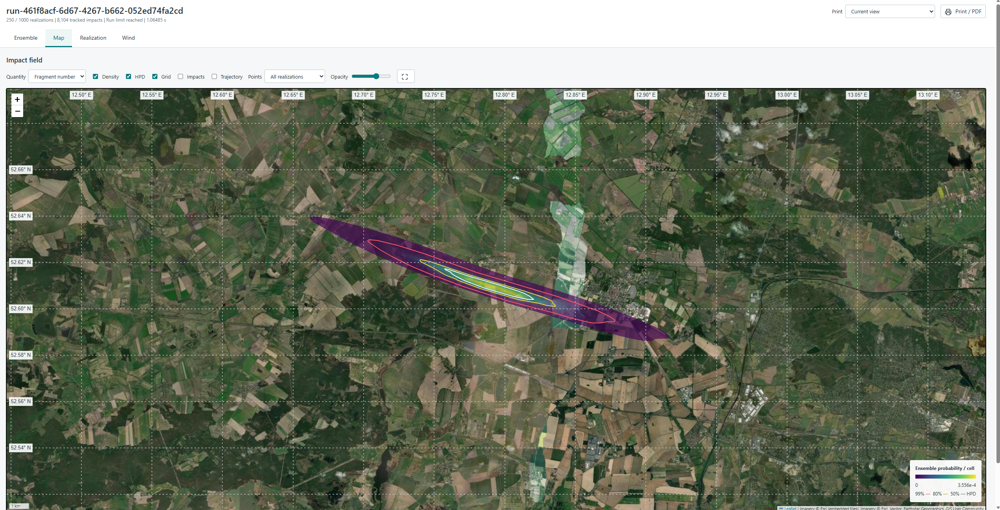

Choose **Fragment number** to view the distribution weighted by fragment
count, or **Surviving mass** to weight it by landed mass. The two maps can
highlight different parts of the same field.

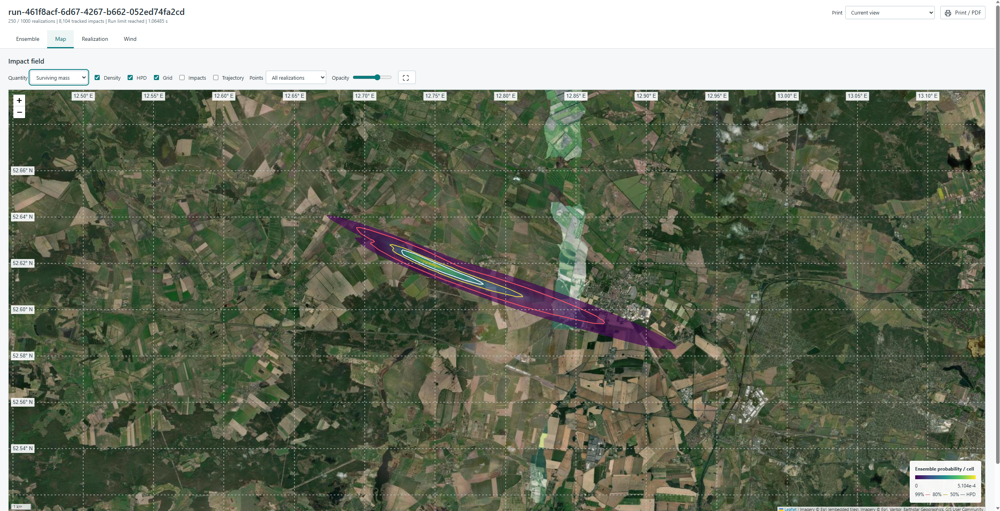

**Density** displays the smoothed distribution. **HPD** adds the 50%, 80% and
99% contours of the normalized, smoothed distribution of landed fragment
number or surviving mass, depending on the selected quantity. Landed fragments
are weighted by realization weight and fragment multiplicity; the mass view
also weights them by surviving mass. These contours do not represent the
probability that at least one fragment lands inside them, or the probability
that fragments survive atmospheric entry.

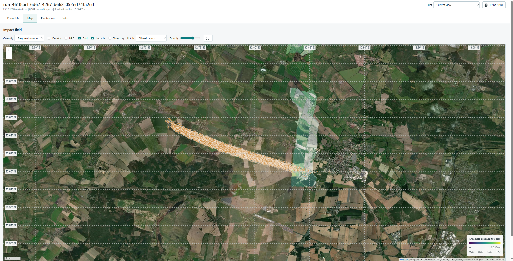

Enable **Impacts** to inspect simulated landing points. For large runs the map
can show a subset of points; the density, contours and distributions use all
saved impacts. The report notes the number displayed when a preview is used.

### Trajectory

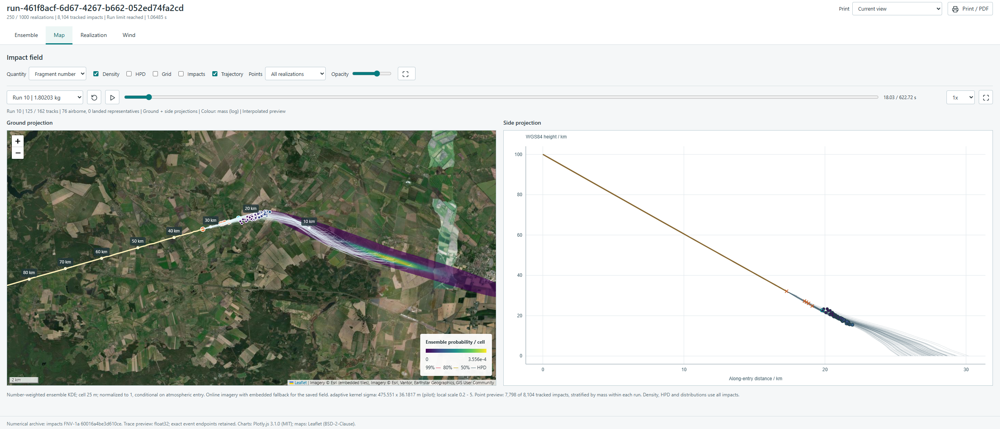

Enable **Trajectory** and choose a realization to view its ground and side
projections. Use the timeline to follow entry, breakup and fragment flight.
The displayed tracks are a preview of the selected realization; their count is
not an estimate of the number of physical fragments.

### Realization

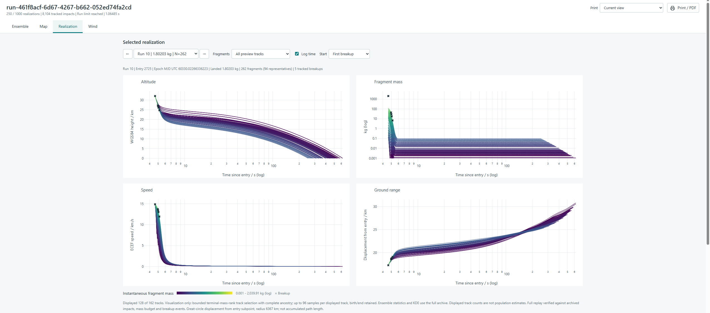

The **Realization** tab plots the height, fragment mass, Earth-fixed speed and
ground displacement over time. Colours indicate fragment mass, and crosses
mark breakup events. Ground displacement is measured from the entry subpoint;
it is not the accumulated length of a fragment's path.

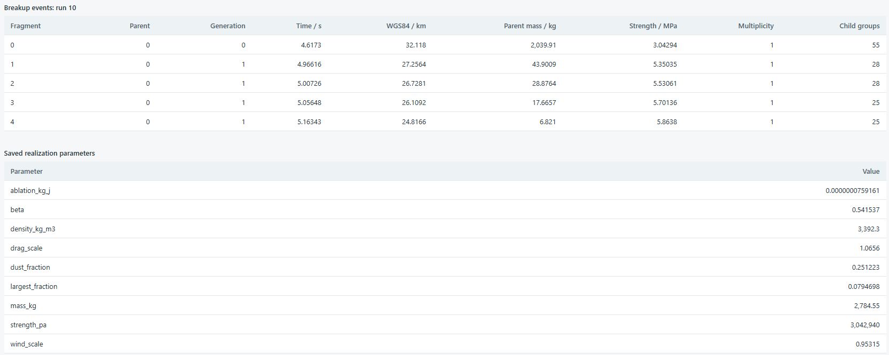

Below the plots, the breakup table lists the parent fragment, time, height,
mass, strength and child groups. The parameters table records the values
sampled for that realization.

### Wind

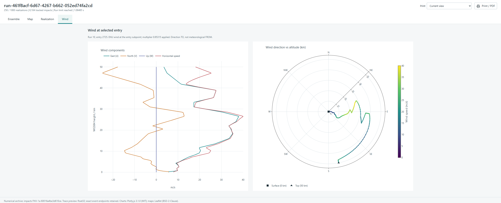

The **Wind** tab shows the east, north and vertical wind components and the
horizontal speed at the selected entry subpoint. The polar plot shows wind
direction and speed with altitude. Its direction is where the wind is going
**to**, rather than the meteorological direction it comes from. The selected
realization's wind multiplier is already applied.

## Saved files

The numerical archive and HTML report are saved under `Atmosphere/run-…` in
the working folder. See [Files and outputs](../../reference/formats/) for the
archive layout. For comparisons with actual events, see
[2023 CX1](../../verification/2023-cx1/) and [2008 TC3](../../verification/2008-tc3/).
