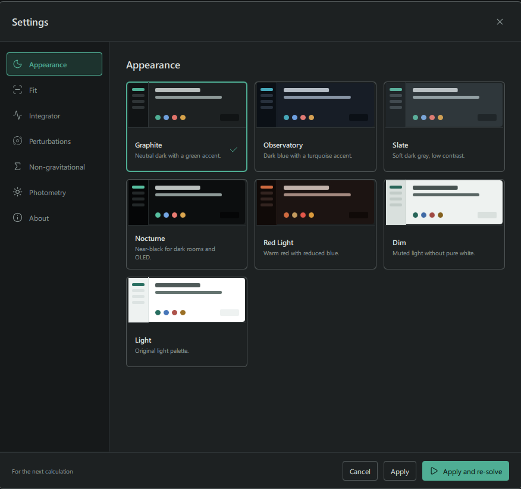
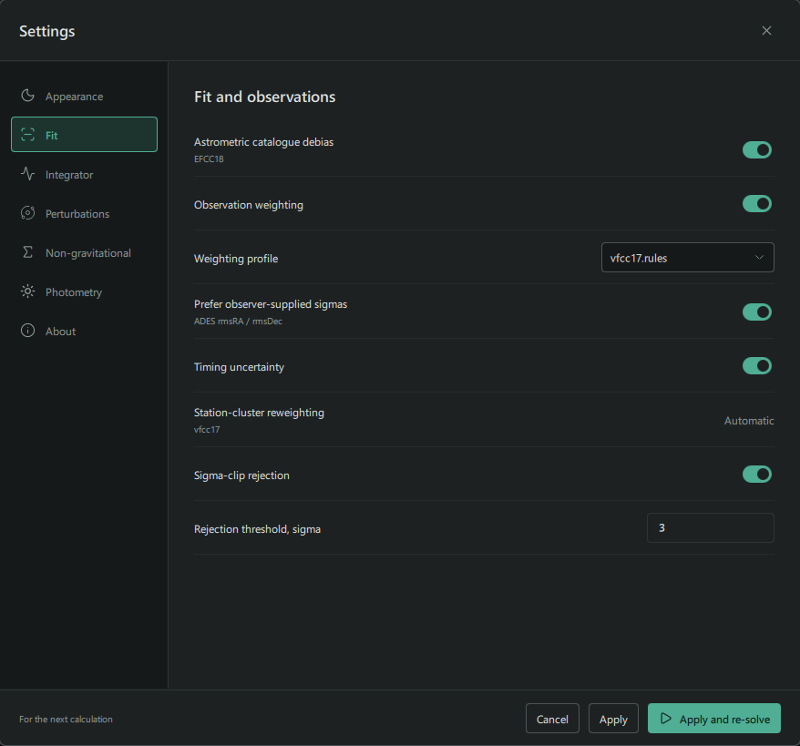
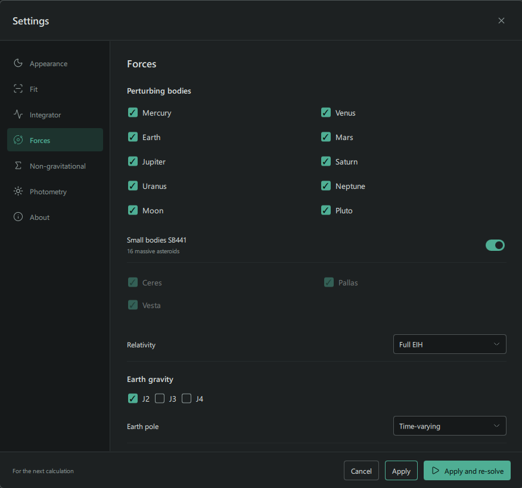
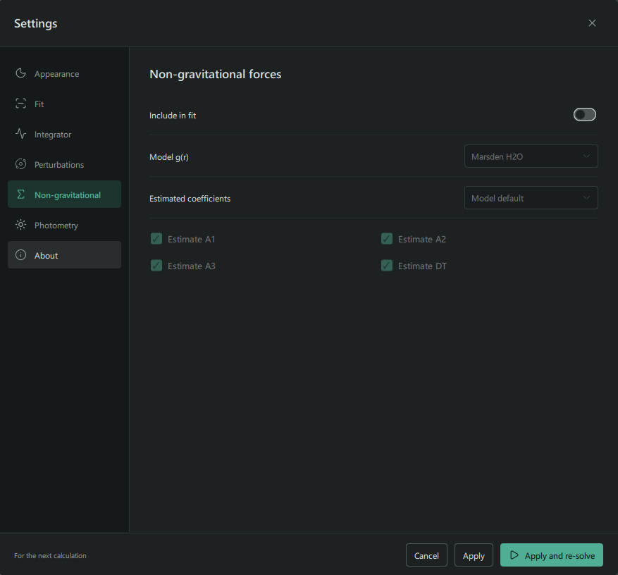
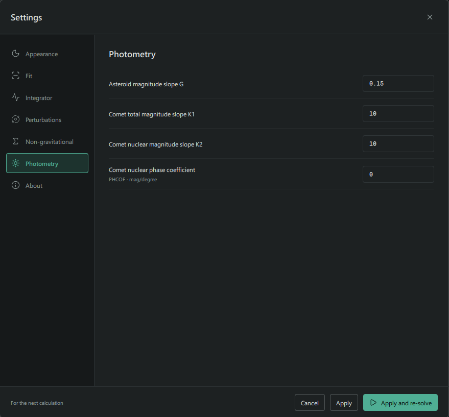

Open **Settings** in the sidebar to configure the next calculation. The dialog
groups options for observations, integration, forces,
non-gravitational forces and photometry.

- **Apply** saves the calculation settings for the next calculation.
- **Apply and re-solve** saves them and starts another fit when an observation
  file is available.
- **Cancel** discards unapplied calculation-setting changes.

On Windows, settings are stored in
`%LOCALAPPDATA%/Trajecta/Trajecta/Trajecta.ini`. On Linux, they are stored in
`Trajecta/Trajecta.ini` under the configuration directory (`~/.config` by
default). If the file does not exist, Trajecta copies existing settings from
the previous storage or creates it with defaults. On Windows, the old registry
settings are removed after they are copied successfully.
The INI groups calculation settings by the sections in the dialog, including
`fit`, `integrator`, `perturbations`, `forces`, `non-gravitational`, and `photometry`.

The screenshots show example settings; they may differ from your current
selection or available data.

## Appearance

Choose a colour theme for the interface. Theme changes take effect when you
select them and do not change the calculation.

## Fit and observations

| Setting | Role |
| --- | --- |
| Astrometric catalogue debias | Applies EFCC18 catalogue corrections when enabled and available. |
| Observation weighting | Enables the selected uncertainty profile. |
| Weighting profile | Chooses `vfcc17.rules` or uniform 0.5 arcsec uncertainties. |
| Prefer observer-supplied sigmas | Allows reported ADES measurement uncertainties to take precedence where applicable. |
| Timing uncertainty | Includes the timing uncertainty term in the measurement model when enabled. |
| Station-cluster reweighting | Applied automatically with VFCC17 weighting; otherwise shown as off. |
| Sigma-clip rejection | Enables automatic residual-based observation selection. |
| Rejection threshold, sigma | Sets the threshold used by automatic selection when sigma clipping is enabled. |

An uncertainty is not a residual: it describes the adopted measurement error,
whereas the residual is the difference between measurement and prediction.
Different uncertainties and observation selections can produce different
orbits from the same input file. Review individual measurements and manual
selection on the [Observations](../observations/) page.

## Integrator

**N-body propagation** enables the numerical dynamics using the planetary
ephemeris. The **Method** field shows the method used by the fit: RA15 when
N-body propagation or a non-gravitational model is enabled, and a Kepler
two-body calculation otherwise.

**Initial step, days** sets the starting integration step; the integrator can
adjust subsequent steps. Accuracy is controlled by the numerical core. The
dialog also shows that light-time correction is enabled for the orbit fit.

## Forces

With N-body propagation enabled, select the planetary and other perturbing
bodies to include. **Small bodies SB441** enables the 16 massive asteroids
provided by the SB441-N16 ephemeris. When it is on, the individual Ceres,
Pallas and Vesta controls are disabled; when it is off, those controls can be
selected individually.

SB441-N16 must be available before it can be enabled. See
[Data Sources](../../data-sources/) for the download. The Sun's central
gravity is part of the propagation and is not a checkbox in this list.

The same page controls additional accelerations:

- **Relativity** selects full EIH, the Sun-only outer sum, or no relativistic
  correction. The Sun-only option retains enabled planetary terms in the inner
  sums.
- **Earth gravity** enables J2, J3 and J4 independently. These terms are used
  when Earth is enabled and the object is within 0.1 AU of its centre.
- **Earth pole** selects a time-varying pole or a fixed J2000 pole for those
  Earth-gravity terms. It does not change the orientation used for observatory
  positions or other coordinate transformations.

Solar J2 is included in N-body propagation and has no separate switch. By
default, full EIH, Earth J2/J3/J4 and the time-varying pole are enabled.

These choices are used in the orbit fit and subsequent calculations based on
that solution. After a converged fit, the solution folder includes a
`Trajecta.ini` snapshot of the application settings at the start of the fit.
Re-solving into the same folder replaces that snapshot.

## Non-gravitational forces

Enable **Include in fit** to estimate non-gravitational coefficients. Select
the distance-dependent law under **Model g(r)** and the parameters under
**Estimated coefficients**:

- **Marsden H2O** and **Marsden CO** use cometary activity laws.
- **Inverse square** uses a distance factor proportional to `1/r²`.
- **Yarkovsky** uses an inverse-square factor with A2 as the estimated
  coefficient; A1 and A3 are fixed to zero in this model.

A1, A2 and A3 are the radial, transverse and normal coefficients. DT is a
time offset supported by the Marsden and inverse-square models. Choose the
estimated set from the menu; the checkboxes below it indicate the selected
coefficients. **Model default** uses the default set for that model.

The [Apophis example](../../orbit-determination/#apophis-fit-a1-and-a2)
shows an inverse-square fit with A1 and A2. Inspect the fitted values, estimated
uncertainties and correlations when evaluating the result.

## Photometry

**Asteroid magnitude slope G** is the slope parameter used in the asteroid
H–G photometric model. **Comet total magnitude slope K1**, **Comet nuclear
magnitude slope K2** and **Comet nuclear phase coefficient** configure the
corresponding comet brightness models. These are photometric settings, not
the A1/A2/A3 force coefficients.

See [Photometry](../../reference/photometry/) for the magnitude models and
how the absolute magnitude is estimated.

## About

**About** shows the application and Qt versions and information about the
numerical methods and solution time scale.

## After changing settings

After changing calculation settings, use **Apply and re-solve**, or select
**Apply** and run **Re-solve** later. Recheck the fit status, observation
selection, residuals and covariance. Previously generated products describe
the solution and settings with which they were computed.
