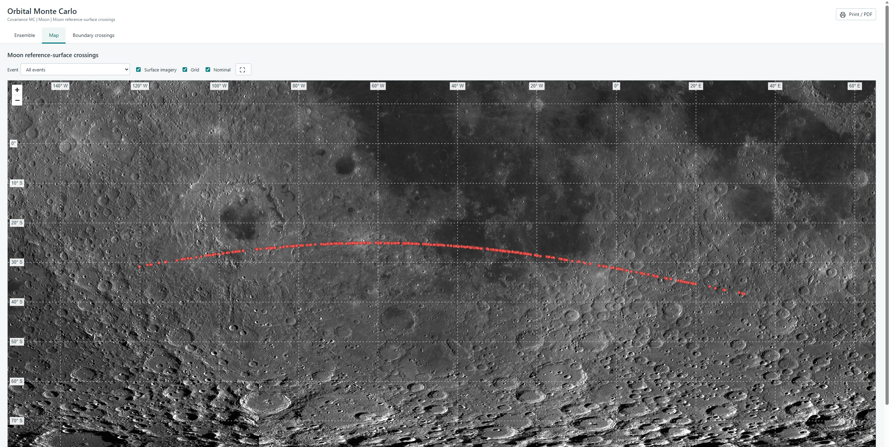

Orbital Monte Carlo follows an ensemble of possible trajectories and records
which ones cross a selected boundary. Trajecta provides two ways to generate
the ensemble: **Covariance MC** and **Observation MC**.

Both methods use the accepted orbit solution and its force model. For a first
run, follow the [2024 YR4 lunar example](../../impact-analysis/).

## Covariance MC

Covariance MC draws random changes to the fitted state from a multivariate
normal distribution. The samples are generated at the fit epoch, preserving
the correlations in the covariance matrix.

When the fit estimates non-gravitational parameters, they are sampled together
with the orbital state, including their correlations. The full fit-epoch
covariance must be available and positive definite.

Each sampled orbit is propagated through the requested interval. Trajecta also
propagates the nominal orbit separately; it is not one of the random samples.

## Observation MC

Observation MC generates a new set of measurements for each trial and fits a
new orbit to it. Perturbations are drawn around the accepted measurements using
their adopted uncertainty information. For optical observations, the model
can include correlation between the two coordinate residuals; radar delay and
Doppler measurements use their respective uncertainties.

Each refit starts from the accepted solution and uses its observation selection,
weighting and force-model settings. The observation mask stays fixed: the
calculation does not run a new rejection procedure for each trial. A failed
refit is reported separately and is not propagated as a valid orbit.

This method includes the refitting step and is generally more expensive than
sampling a covariance. Its results need not match Covariance MC: the methods
represent and propagate uncertainty in different ways.

## Configure a run

1. Fit an orbit and open **Risk Monitor** → **New calculation**.
2. Select **Covariance MC** or **Observation MC** and check **Source data**.
3. Under **Event date**, choose **Set date** for a UTC centre and half-window,
   or **Date range** for a start and end. The interval must start at or after
   the fit epoch.
4. Select **Earth**, **Moon** or **Mars**. For Earth, choose **Surface** or
   **Atmospheric entry · 100 km**; Moon and Mars use their surface boundary.
5. Enter the sample count and **Seed**, then select **Run**. Save the seed with
   the solution, settings and data versions when comparing runs.

Samples start at the fit epoch, even when the search interval starts later.
The orbit is propagated to the interval; the covariance is not replaced by a
new Gaussian approximation at the start date.

## Example: 2024 YR4 lunar crossings

The repository contains historical observation sets for 2024 YR4 under
[`data/examples/NEO/impacts/2024YR4`](https://github.com/dtereshchenko-dev/Trajecta/tree/master/data/examples/NEO/impacts/2024YR4).
The May 2025 lunar file was assembled manually; it is not an original MPEC
publication. For a step-by-step calculation, see
[Impact Analysis](../../impact-analysis/#example-2024-yr4-and-the-moon).

After the run, open the HTML report and inspect the ensemble, event table and
lunar map together. The points show simulated crossings of the lunar reference
surface; they are not observed impacts. This historical example is not a
current assessment of lunar impact probability.

Lunar imagery: LRO WAC mosaic, NASA / GSFC / ASU / USGS.

## Read the results

Open **Runs** and select a calculation. Check the requested and completed
counts, fit and propagation errors, and whether the run was cancelled. A miss
is a successfully propagated trajectory without a boundary crossing; a failed
trial is not a miss.

The event table groups crossings by time. When consecutive crossings are more
than 24 hours apart, a new event begins. **Entries** counts the crossings in an
event and **P** is their fraction among completed trials. The separately
propagated nominal trajectory does not create an event or contribute to this
probability. The 95% Wilson interval describes sampling uncertainty for the
adopted model; it does not include systematic or force-model errors. A
cancelled run may be biased, and zero crossings do not prove zero probability.

Use the report and folder buttons to inspect the HTML report and saved data.
The map shows crossings of the selected reference surface, not meteorites on
the ground. See [Files and outputs](../../reference/formats/) for the saved
archives.

To model what happens after an Earth entry, continue with
[Atmospheric Monte Carlo](../atmospheric-mc/). Its results describe the
consequences conditional on the supplied entry, not a new orbital probability.
