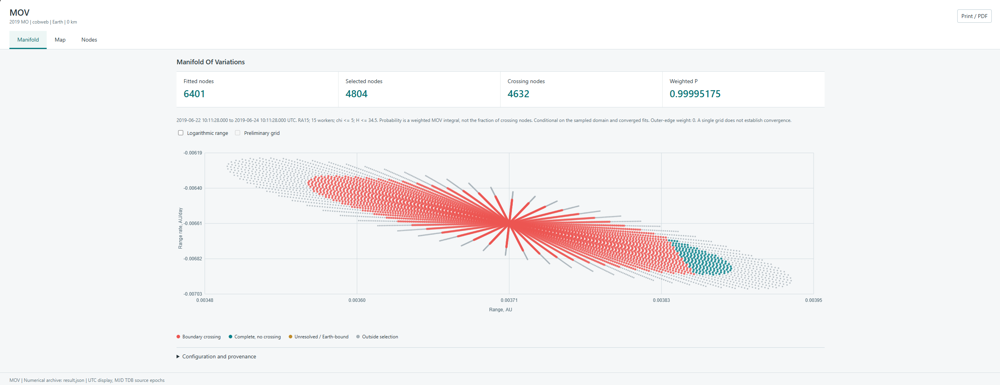
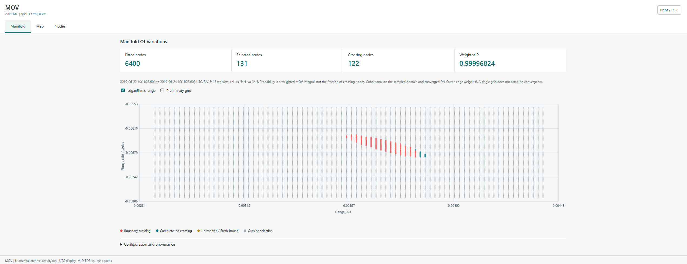
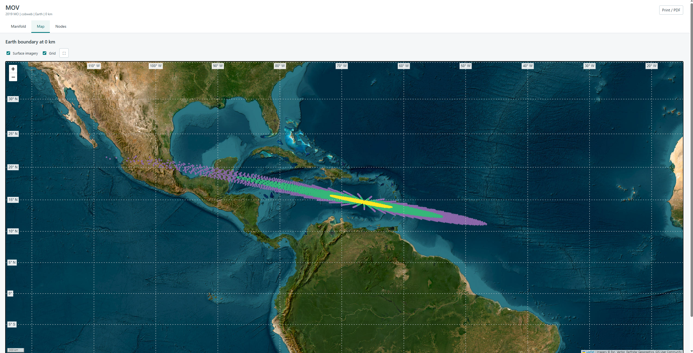
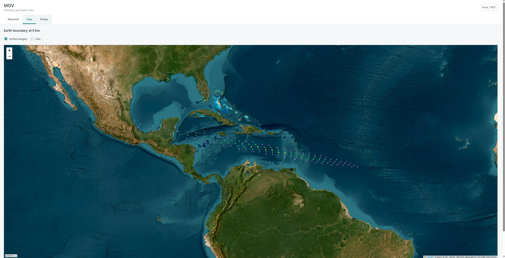
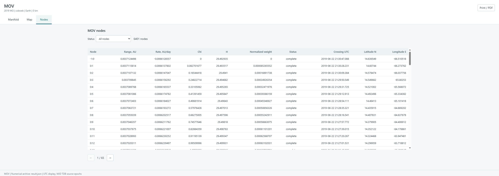
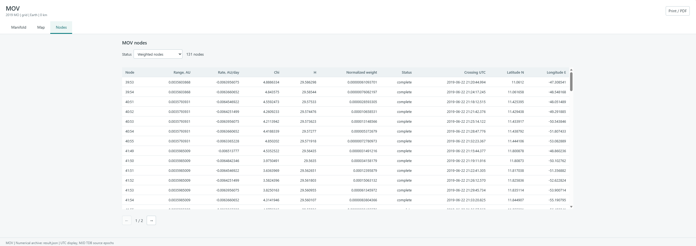
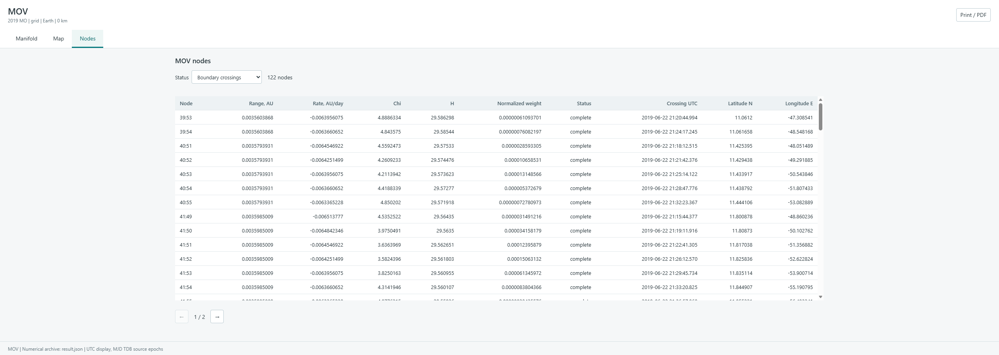
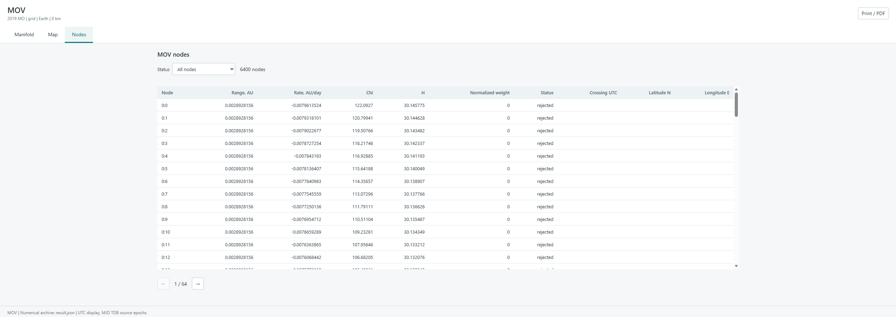

The Manifold of Variations (MOV) explores possible orbits for a short arc of
observations. Instead of drawing random orbits from a covariance, it samples
distance and range rate, fits the remaining attributable coordinates at each
node, and propagates eligible solutions to the selected boundary.

## Prepare the observations

MOV uses weighted, ground-based optical observations and gravity-only N-body
dynamics. Usable photometry is required for the absolute-magnitude
selection. The observation arc and prediction horizon are limited to 30 days;
the search interval must begin at or after the attributable epoch and end
within 30 days of it.

From **Risk Monitor**, choose **MOV**. Use the current solution's observations
or open another observation file. For the current solution, **Accepted fit
mask** keeps its selected observations; **All observations** uses the full set.
The chosen selection remains fixed at every MOV node.

## Choose the sampling

Set the UTC start and end, target and reference boundary. Then choose a method:

| Method | Sampling |
| --- | --- |
| Admissible-region grid | Samples a grid in range and range rate within the admissible region. A preliminary grid helps define the final sampling region. |
| Cobweb | Samples directions and radial nodes around a nominal solution using its covariance. |
| Automatic | Uses Cobweb when its prerequisites are met; otherwise uses the admissible-region grid. |

Cobweb requires a converged nominal solution, a suitable 6 × 6 covariance and
sufficiently measured curvature. If it is unavailable, use **Automatic** or
the grid. Set the node counts and workers, then select **Run**.

Each node is fitted with its sampled range and range rate held fixed. The
displayed selection uses **χ ≤ 5** and **H ≤ 34.5**; a node must pass both
tests to contribute weight. Here χ is the square root of the increase in the
weighted fit objective relative to the best eligible fit in the sampled set.

## Read the results

The run summary reports fitted, weighted and crossing nodes, failed fits or
propagations, and **Weighted P**. Node weights account for fit quality and the
geometry of the manifold and sampling. Therefore, weighted probability is not
the number of crossing nodes divided by the total number of nodes.

**Weighted P** depends on the sampled domain, the adopted weighting measure,
and the χ and H selection. It is not a bound on the physical impact probability.
Earth-bound nodes retain their weight in the normalization but are not
propagated or counted as boundary crossings.

Open the report to inspect the manifold, boundary-crossing map and individual
nodes. A point on the map is a crossing of the selected reference boundary.
When a nominal solution is available, its trajectory is reported separately.

### Manifold

The **Manifold** tab plots the sampled nodes by observer distance (**Range**)
and its rate of change (**Range rate**). Colours show the outcome: red for a
boundary crossing, teal for a completed trajectory without a crossing, amber
for unresolved or Earth-bound nodes, and grey for nodes outside the selection.
Move the pointer over a point to inspect its values.

In this 2019 MO run, 4,632 nodes cross the selected boundary, but **Weighted P**
is not `4,632 / 4,804`: each selected node contributes according to its weight.
The figures at the top distinguish fitted nodes, selected nodes with nonzero
weight and crossing nodes.

The same object can also be explored with **Admissible-region grid**. Unlike
the cobweb above, the grid samples rows and columns of range and range rate.
In the run below, 131 of 6,400 fitted nodes have nonzero weight, and 122 nodes
cross the boundary. **Logarithmic range** changes the plot's horizontal scale;
**Preliminary grid** displays the earlier grid used to define the final region.

### Map

The **Map** tab places the crossing nodes on the selected body's reference
surface. For this example, the boundary is the Earth surface at 0 km. The
colours on the map represent χ bands: yellow for χ < 1, green for 1 ≤ χ < 3,
and purple for 3 ≤ χ ≤ 5. They do not have the same meaning as the colours on
the manifold plot.

Select a point for its node, crossing time, χ and normalized weight. These
locations describe the sampled orbital crossings, not an atmospheric
fragmentation or meteorite fall calculation.

The grid run displays fewer crossing points because its sampling differs from
the cobweb run. The number of crossing nodes should not be compared directly
between grid and cobweb runs as a measure of impact probability:

### Nodes

The **Nodes** tab lists the sampled solutions. It includes range and range
rate, χ, estimated absolute magnitude **H**, normalized weight, status and,
for crossings, the UTC time and coordinates. Use **Status** to filter the
table and the arrows to move between pages.

The normalized weight is the node's contribution relative to the total weight
of the sampled set. A fitted node can have zero weight; for example, the
central cobweb point shown above is included in the table but has no quadrature
weight.

For the grid run, **Weighted nodes** shows the 131 nodes with nonzero weight:

**Boundary crossings** narrows the table to the 122 crossing nodes:

**All nodes** also shows nodes outside the selection. In the rows below, the
fits are listed as `rejected` and have zero weight:

Review the warnings before interpreting the probability. In particular:

- If accepted nodes reach the sampled boundary, the domain may truncate part
  of the solution. Check the domain coverage and the grid resolution separately:
  adding nodes within the same domain does not recover an omitted region.
- Failed constrained fits are not resolved solutions. Missing photometry can
  also exclude nodes from the magnitude selection.
- If a weighted node fails propagation, Trajecta reports lower and upper
  probabilities for the known missing weight. This bracket does not account
  for unresolved fits or unsampled regions.

See the [2019 MO comparison](../../verification/2019-mo/) for a documented
MOV comparison with OrbFit. LOV tracing is a separate method and is not
currently a Risk Monitor UI mode.
