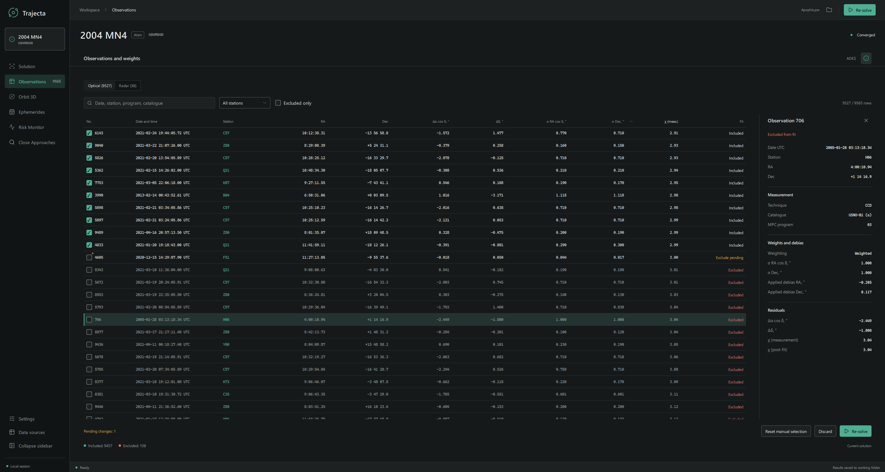
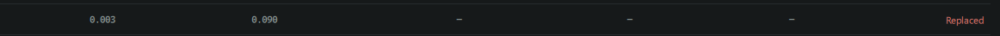
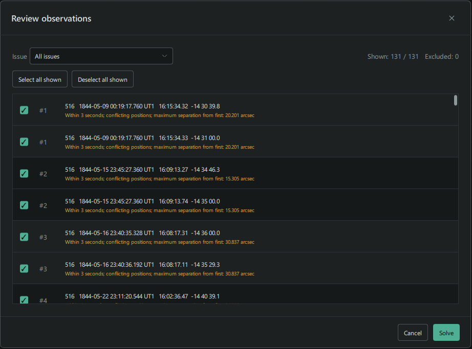
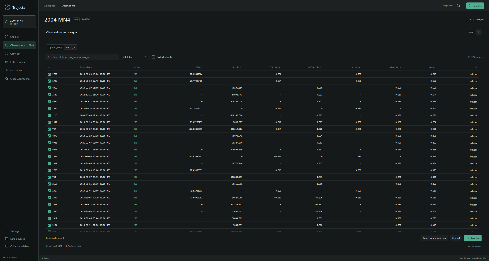

The **Observations** page lists the measurements used to determine an orbit.
Here you can inspect their residuals and weights, find observations from a
particular station, and change which measurements are included in the fit.

This guide uses the bundled `examples/NEO/Apophis.psv` as an optical example.
Open it and obtain an orbit solution, then select **Observations** in the
sidebar. For the orbit-fitting workflow, see [Orbit determination](../../orbit-determination/).
The fields and observation selection depend on the input file and calculation
settings.

## Read the optical table

Each row represents an observation. The checkbox at the left controls its
inclusion in the fit; the **Fit** column shows its current or pending status.
Click a column heading to sort the table by that value. Use the horizontal
scrollbar when the table does not fit in the window.

| Column | What it shows |
| --- | --- |
| No. | Observation number in the loaded set. |
| Date and time | Observation epoch with its time scale, such as UTC or UT1. |
| Station | Observatory code. |
| RA, Dec | Submitted sky coordinates. |
| Δα cos δ, Δδ | Right ascension and declination residuals in arcseconds. |
| σ RA cos δ, σ Dec | Adopted uncertainties in arcseconds, when available. |
| χ (meas.) | Measurement residual normalized using the adopted uncertainty model. |
| Fit | Whether the observation is included, excluded, replaced or awaiting a change. |

Residuals use **O−C**: observation minus computed prediction. For optical
observations, catalogue corrections are applied when enabled. The
right-ascension residual includes the `cos δ` factor, as does its corresponding
uncertainty. A large χ is a useful reason to inspect a measurement, not a
reason to remove it automatically.

### Replaced observations

**Replaced** identifies a record marked as replaced in the MPC data (`X` or
`x` in the observation type). It is excluded from the fit by default, rather
than rejected because of its residual. Its weight and χ are not shown while
it remains excluded.

The record remains visible in the table. You can explicitly include it using
the checkbox and **Re-solve**, but check the observation and its replacement
before doing so.

## Find observations

Use the search field to find a date, station, program or catalogue. The
**All stations** menu narrows the table to one observatory; **Excluded only**
shows observations excluded from the current fit. The row counter shows how
many entries match the current view.

If no rows match, use **Clear filters** to return to the full list. You can
also open observations for a station from **Residuals by station** on the
solution overview.

## Inspect a measurement

Select an observation row to open its details. Depending on the window width,
the details appear in a side panel or a dialog. The information button in the
page header also opens the selected observation's details.

For an optical observation, the details include its date, station and
coordinates, followed by:

- **Measurement:** technique, astrometric catalogue and MPC program when
  supplied.
- **Weights and debias:** weighting status, adopted uncertainties and applied
  catalogue corrections.
- **Residuals:** the two angular residuals and the available measurement and
  post-fit χ diagnostics.

The details reflect the current solution; some values can be unavailable if
the input or calculation does not provide them.
For the definitions of both χ values, see
[Residual statistics](../../reference/observation-model/#normalized-residual-statistics).

With VFCC17 weighting, the MPC program code can also be used to select a
weighting rule, together with the station, technique, catalogue and date. Its
effect depends on the matching rules and the chosen uncertainty settings.

## Include or exclude observations

1. Clear the checkbox beside a measurement to exclude it, or select it to
   include it. The row is marked as a pending change.
2. Review the pending changes and select **Re-solve** at the bottom of the
   page. The orbit and residuals are recalculated using that selection.
3. Check the fit status and the updated results after the calculation finishes.

Until you re-solve, the displayed residuals belong to the current solution,
not the pending selection. **Discard** abandons pending edits and restores the
last accepted manual choices. **Reset manual selection** returns manual
choices to automatic selection; use **Re-solve** to apply that change. Automatic
sigma clipping is configured separately in **Settings**.

## Review issues before a fit

When Trajecta finds observations that need attention while loading a file, a
**Review observations** dialog can appear before solving. It groups potential
issues such as matching times and positions, conflicting nearby measurements,
an object below the horizon, or daylight at the submitted time.

Filter by issue and inspect the listed records before changing their
checkboxes. **Select all shown** and **Deselect all shown** act on the displayed
records. Select **Solve** to continue, or **Cancel** to stop. A flagged record
is a prompt to review the measurement and its metadata, not by itself proof
that it is wrong.

## Radar observations

When the loaded set contains radar measurements, use the **Optical** and
**Radar** controls above the table to switch between them. The radar view
shows the receiver, delay and Doppler or range rate, their O−C residuals,
uncertainties and fit status. Select a row for transmitter, frequency, return
type and per-channel details when available.

Delay is displayed in seconds; its O−C residual and uncertainty are in
microseconds. Doppler shift, residual and uncertainty are in hertz; when the
table shows range rate instead, those values are in metres per second.

See [Fit settings](../fit-settings/) for weights, debiasing and selection, and
[Observation model](../../reference/observation-model/) for the underlying
measurement conventions.
