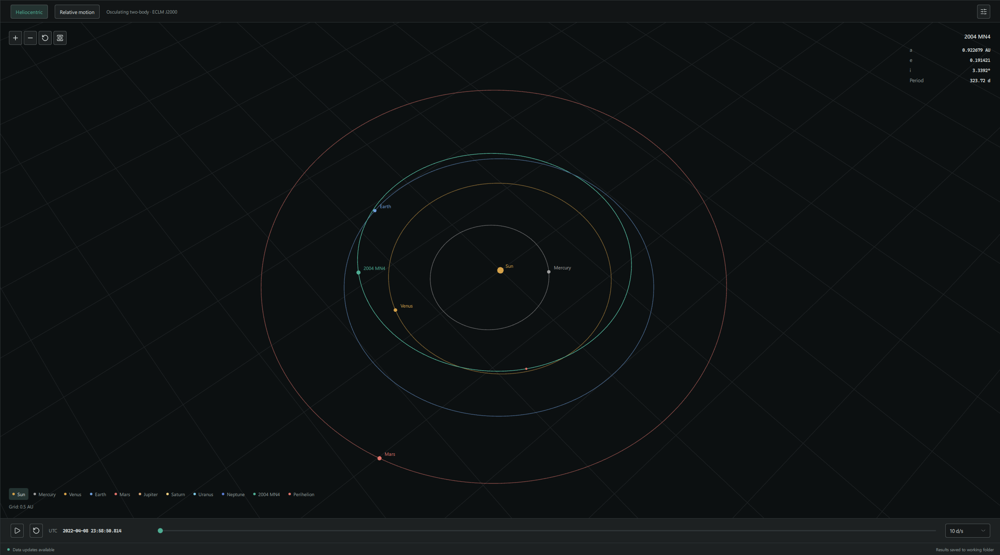
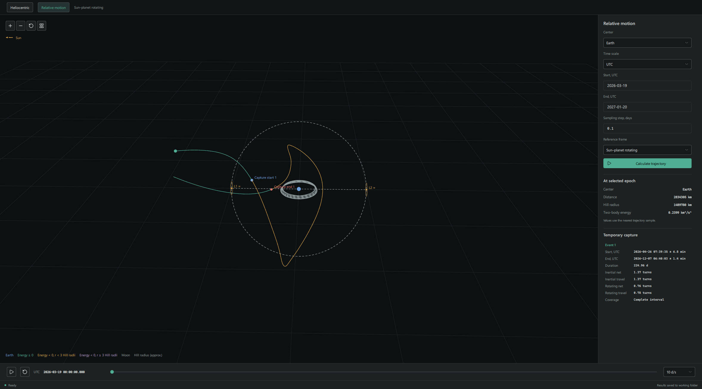
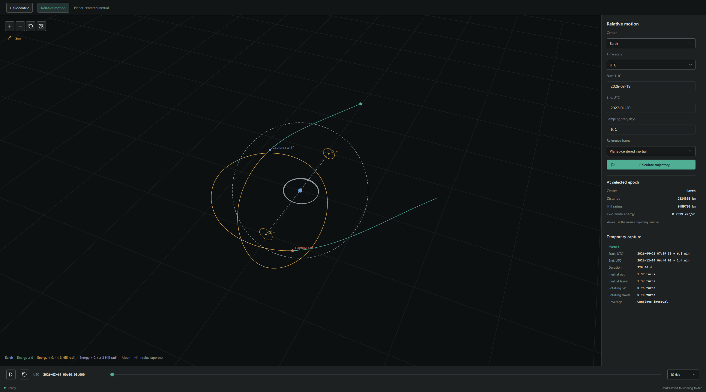
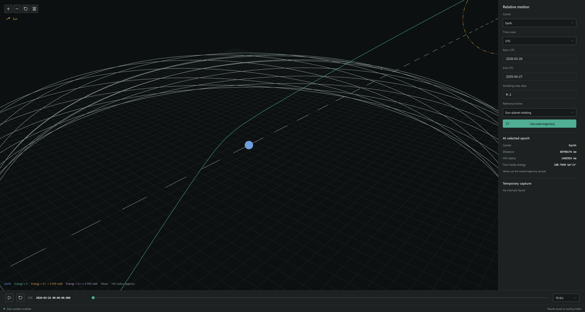
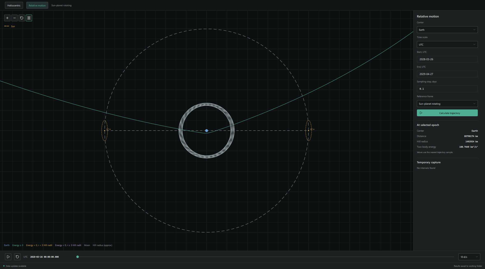
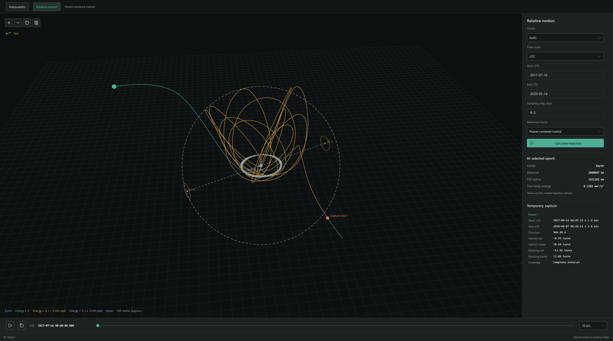
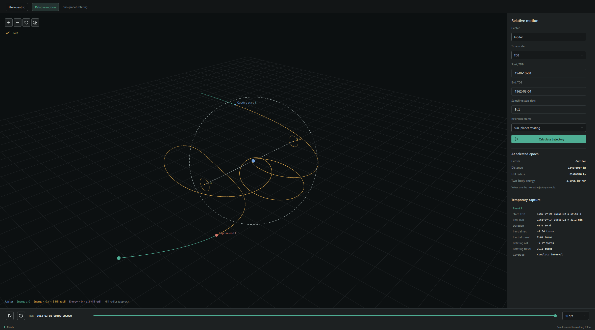

Open **Orbit 3D** after solving an orbit. The page offers a heliocentric view
and a separate calculation of motion relative to a planet.

In both views, the top-view control switches to an orthographic projection
looking down on the reference plane. Rotating away from that view or resetting
the camera restores perspective projection.

## Heliocentric orbit

**Heliocentric** shows the object's osculating orbit around the Sun alongside
the planets. The animation follows a two-body orbit; use **Relative motion**
or **Close Approaches** to study a planetary encounter.

## Relative motion

**Relative motion** follows the nominal orbit relative to the selected
planet. It uses the current solution and its force model, including any fitted
non-gravitational parameters.

To explore the Earth encounter of 2026 QQ8:

1. In **Settings → Non-gravitational**, enable **Include in fit**, select
   **Inverse square** for **Model g(r)** and **A1** for **Estimated coefficients**.
2. Open and solve the object's observations, then select **Orbit 3D** and
   **Relative motion**.
3. Choose **Earth** as the centre and **UTC** as the time scale.
4. Set the interval to `2026-03-19` through `2027-01-20` and the sampling
   step to `0.1` days.
5. Select **Sun–planet rotating** and choose **Calculate trajectory**.

The toolbar has controls to reset the view and look down on the reference
plane. Use the timeline to select an epoch or play the motion. The Sun
indicator shows the Sun's direction in the current view.

The two reference frames show the same calculated motion from different
viewpoints:

- **Sun–planet rotating** turns with the planet's motion around the Sun.
  The Sun remains on the same side of the planet in this frame.
- **Planet-centered inertial** keeps the axes fixed in the J2000 ecliptic
  frame while the Sun's direction changes.

The shape of the path and the number of turns depend on the chosen frame;
the underlying trajectory does not change.

## Reading the view

The point on the path marks the object at the selected epoch. **At selected
epoch** shows its distance from the planet, the approximate Hill radius and
the planet-relative two-body specific energy. These values use the nearest
trajectory sample.

The trajectory colours distinguish non-negative energy, negative energy
within three Hill radii, and negative energy farther away. The dashed circle
is an approximate Hill-radius guide; the L1 and L2 markers show approximate
positions along the Sun–planet direction. The circle faces the camera, so a
crossing in the view alone does not establish a crossing of the three-dimensional
Hill sphere. For Earth, the Moon's sampled path is also shown.

## Temporary capture

The panel lists intervals where the nominal orbit has negative planet-relative
two-body energy and is within three Hill radii. Start and end markers appear
on the path. Select an event to pause playback, move the object to its start
and focus the camera there.

Each event shows its start, end and duration, as well as turns in both frames:

- **Net** is the signed change in longitude: opposite directions can cancel.
- **Travel** adds the absolute angular changes, including any reversals.

Inertial turns are measured in the J2000 ecliptic plane; rotating turns use
the moving Sun–planet orbital plane. These projected angles are not necessarily
counts of complete three-dimensional revolutions.

Start and end uncertainties are displayed as linearized 3σ estimates when
available. They describe local uncertainty for the adopted orbit and force
model; strongly nonlinear encounters or unmodelled effects can make them
unreliable. The **Hill sphere** section lists passages that overlap the capture,
including their entry and exit times even when these lie outside the capture.
Their 3σ estimates use the same fit covariance and are calculated separately
for each crossing. A clipped boundary or unavailable covariance has no estimate.
**Partial interval** means the event extends beyond at least one
edge of the requested calculation; its displayed duration is then a lower
bound. Boundaries are interpolated between samples, so a smaller step can help
resolve short events and their timing.

### Apophis: Earth flyby

Apophis passes close to Earth in April 2029. In the calculation shown here,
**Relative motion** displays the flyby but finds no temporary capture interval.
The two views below show the same path from different camera angles.

### Example: 2020 CD3 and Earth

For 2020 CD3, enable **Inverse square** with **A1** as the estimated coefficient
before solving its observations. In **Relative motion**, select **Earth**,
**UTC**, the interval `2017-07-16` to `2020-05-14`, a `0.1`-day step and
**Planet-centered inertial**. Then select **Calculate trajectory**.

The displayed solution has a capture interval from September 2017 to May 2020.
Switch frames to compare its appearance and the corresponding turn counts.
The results depend on the observations, fit settings and force model.

### Example: 147P and Jupiter

The following view uses historical observations of 147P/Kushida–Muramatsu
through 20 March 2002, with non-gravitational accelerations disabled. It does
not use the full modern observation set. Before solving the orbit, disable
**Prefer observer-supplied sigmas** in **Settings → Fit**. Then choose
**Jupiter**, **TDB**, the interval `1948-10-01` to `1962-03-01`, a `0.1`-day
step and the rotating frame. TDB is useful for dates before 1960, where UTC
conversion is unavailable.

In this calculation, the capture interval runs from July 1949 to July 1961.
[Ohtsuka et al. (2008)](https://arxiv.org/html/0808.2277v1) report a capture
from May 1949 to July 1961, with two completed revolutions around Jupiter. The
Trajecta start date falls within the range of start dates reported for their
clones; the exit dates are about a day apart. The two calculations use different
orbit solutions, and the displayed turn measures need not match the paper's
revolution count directly.

The [dynamics reference](../../reference/dynamics/#temporary-capture-in-relative-motion)
describes the quantities and the limits of the calculation.
