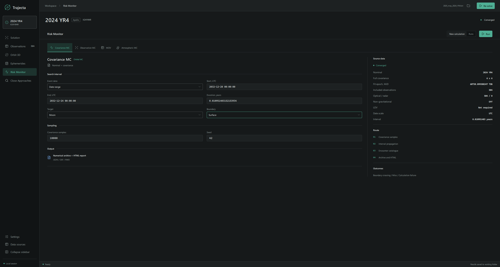
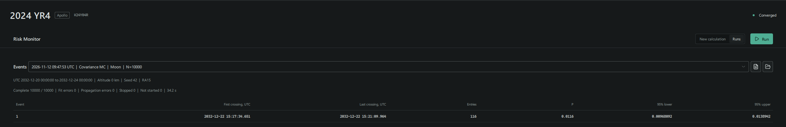

**Risk Monitor** explores possible trajectories around an orbit solution. You
can sample its covariance, refit simulated observations, or explore an admissible
region with MOV. A separate atmospheric calculation follows an object after it
enters Earth's atmosphere.

## Example: 2024 YR4 and the Moon

This example uses a manually assembled file of 2024 YR4 observations through
May 2025. It is not an original MPEC publication. The example illustrates how
to run an analysis; it is not a current risk assessment.

1. Open `data/examples/NEO/impacts/2024YR4/moon/2025_may_2024_YR4.txt`
   and let Trajecta fit the orbit. On **Solution**, check the fit and its
   covariance before continuing.
2. Open **Risk Monitor**, choose **New calculation**, then **Covariance MC**.
3. Under **Event date**, select **Date range**. Set a UTC interval containing
   22 December 2032, for example from `2032-12-20 00:00:00` to
   `2032-12-24 00:00:00`.
4. Select **Moon** as the target and **Surface** as the boundary. Choose a
   sample count, such as 10,000, and a seed. The same seed and settings make
   a run easier to reproduce.
5. Review **Source data** on the right and select **Run**. When it finishes,
   open **Runs** and select the calculation.

The result depends on the observations, fit, uncertainty model and force model
used. Different observation sets or settings can produce different results.

## Read the result

Start with the run summary: check how many trials completed and whether any
fits or propagations failed. A completed trajectory that misses the boundary is
different from a failed calculation; failures are not counted as misses.

The event table groups crossings by time. **Entries** is the number of sampled
trajectories that crossed the selected boundary, and **P** is their fraction
among completed trials. The lower and upper columns give a 95% Wilson interval.
The nominal trajectory is shown separately and does not count as a trial.

:::caution[Historical example]
This is not a current lunar impact probability.
:::

In this run, all 10,000 trials completed and 116 crossed the lunar surface.
The displayed probability is `0.0116`, or **1.16%**. The reported 95% interval
is approximately **0.97% to 1.39%**.

The Wilson interval describes finite-sample uncertainty for the adopted orbit
and uncertainty model. It does not include systematic errors or uncertainty
in the model itself.

A finite sample has statistical uncertainty. For example, no crossings in
10,000 trials does not prove that the probability is zero. Increase the sample
size when investigating a small probability and check the reported interval.
Cancelled runs may contain partial results.

## Open the report and files

In **Runs**, select the calculation and use the report or folder button to open
the HTML report or saved files. The report includes the ensemble, event table
and map. Map points show crossings of the selected reference boundary; they
are not meteorite recovery locations.

For event grouping and probabilities, see [Orbital Monte Carlo](../guide/monte-carlo/#read-the-results).
The [file reference](../reference/formats/) describes the saved archives.

## Choose a method

| Method | What it does | Guide |
| --- | --- | --- |
| Covariance MC | Samples possible states and fitted non-gravitational parameters from the solution covariance. | [Orbital Monte Carlo](../guide/monte-carlo/) |
| Observation MC | Perturbs measurements and refits an orbit for each trial. | [Orbital Monte Carlo](../guide/monte-carlo/) |
| MOV | Explores fitted orbits sampled across an admissible region. | [Manifold of Variations](../guide/mov/) |
| Atmospheric MC | Models entry, fragmentation and dark flight from entry states. | [Atmospheric Monte Carlo](../guide/atmospheric-mc/) |

Covariance MC and Observation MC describe uncertainty differently and need not
produce identical probabilities. MOV uses weighted nodes and has its own
coverage and model constraints; see its guide before running it.

Atmospheric MC answers a different question: given an entry, what could happen
in the atmosphere and where might fragments land? Its conditional distribution
is separate from the orbital probability of crossing the entry boundary.

For more examples, see [2024 YR4: lunar crossings](../guide/monte-carlo/#example-2024-yr4-lunar-crossings) and
the [2019 MO MOV comparison](../verification/2019-mo/).
