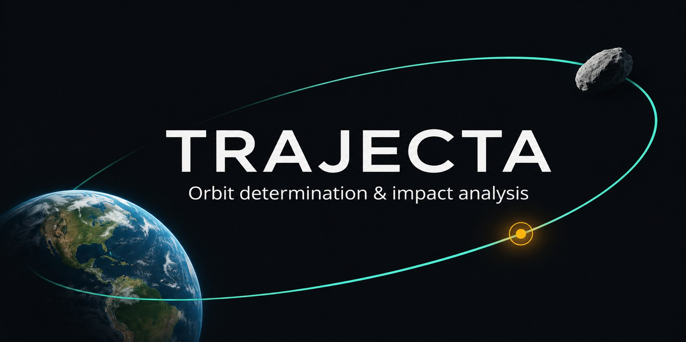

Trajecta is a desktop application for determining the orbits of asteroids and
comets, generating ephemerides, and exploring close approaches and impact
scenarios.

## Start here

- [Getting started](./getting-started/): install the application and solve your first orbit.
- [Orbit determination](./orbit-determination/): observations, fit settings, residuals and covariance.
- [Ephemerides and close approaches](./ephemerides-and-close-approaches/): generate positions and search for encounters.
- [Impact analysis](./impact-analysis/): orbital Monte Carlo, MOV and atmospheric simulation.
- [Data sources](./data-sources/): ephemerides, observatory catalogues and other runtime data.

## Work through an example

- [2024 YR4: lunar boundary crossings](./guide/monte-carlo/#example-2024-yr4-lunar-crossings)
- [2019 MO: MOV comparison](./verification/2019-mo/)

For downloads and a feature overview, see the
[project repository](https://github.com/dtereshchenko-dev/Trajecta) and
[releases](https://github.com/dtereshchenko-dev/Trajecta/releases). For command-line
and build instructions, see the
[CLI guide](https://github.com/dtereshchenko-dev/Trajecta/blob/master/TrajectaCLI/README.md)
and [developer guide](https://github.com/dtereshchenko-dev/Trajecta/blob/master/DEVELOPMENT.md).

## Status and feedback

Trajecta is under active development and testing. Results depend on the input
observations, data sources, models and settings. Independently verify important
results before drawing conclusions.

Found a problem? [Open an issue](https://github.com/dtereshchenko-dev/Trajecta/issues)
and include the steps to reproduce it, relevant settings and logs when available.
