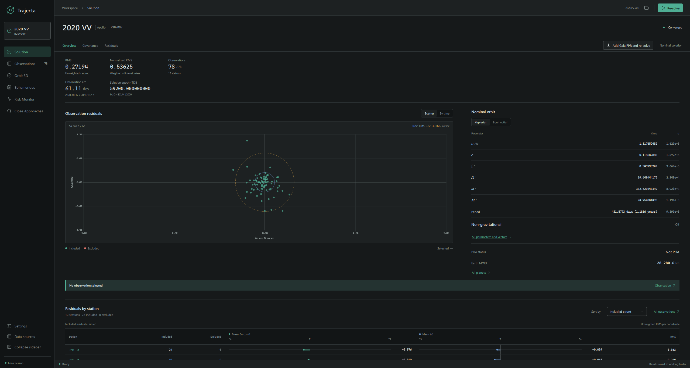
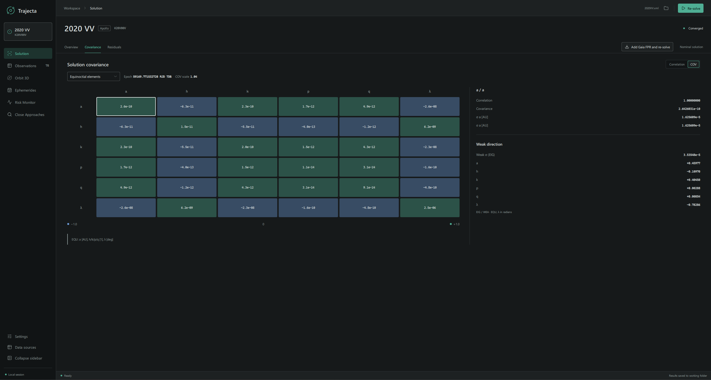
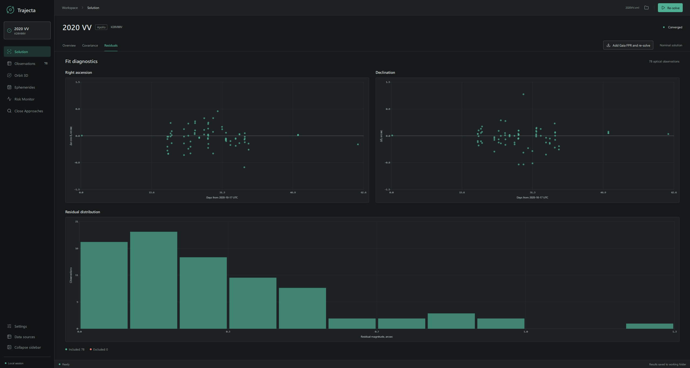
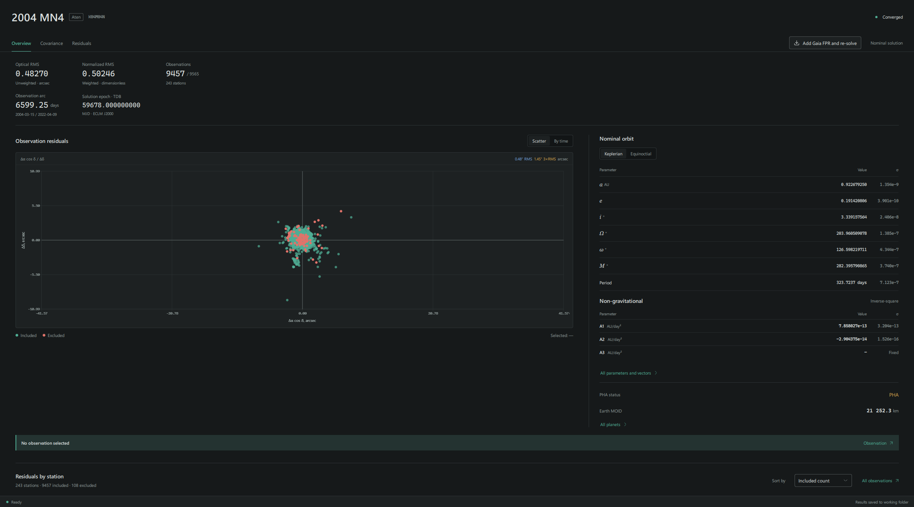
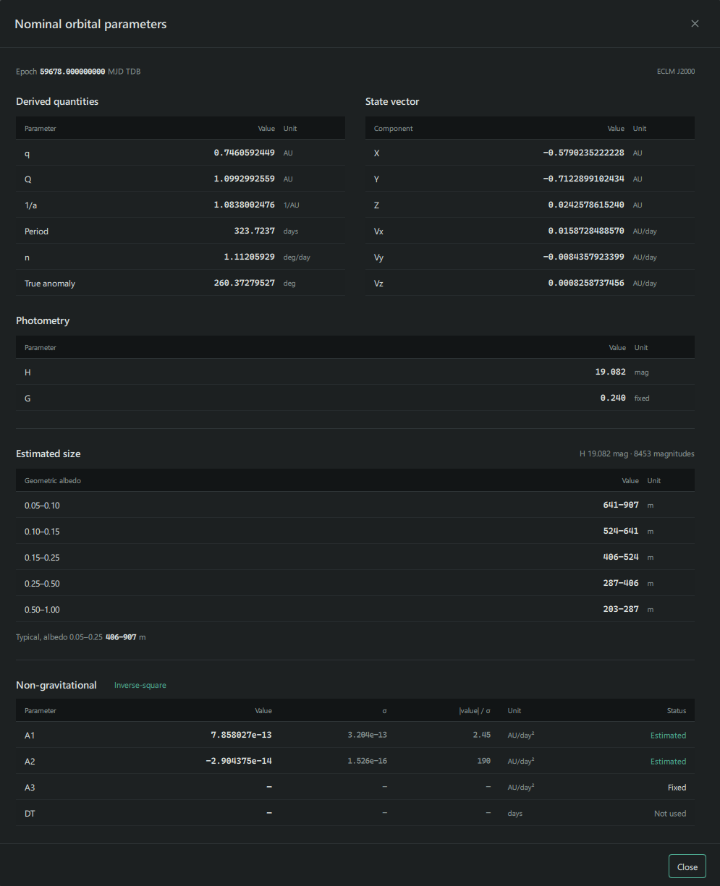
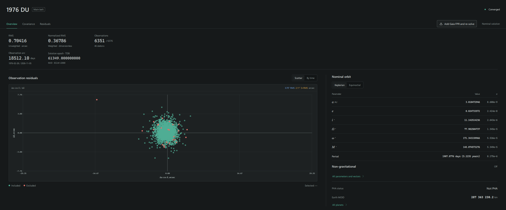
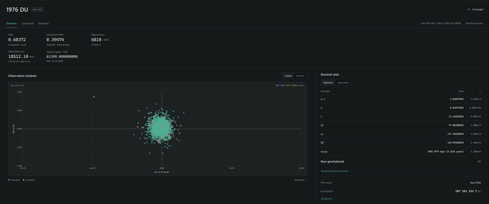

Trajecta determines asteroid and comet orbits from optical and radar
observations in MPC 80-column and ADES XML/PSV files. This guide uses 2020 VV
to explain the solution screen, estimates non-gravitational parameters for
Apophis, and adds Gaia FPR observations to a solution for (12104) Chesley.

## Solve 2020 VV

1. In **Settings**, leave the non-gravitational model off for this example.
   Check the required sources in **Data sources**.
2. Open `examples/NEO/2020VV.xml` from the installation folder, or drag the
   file into Trajecta. Processing starts when the file is opened. If the
   observation review appears, review the measurements and continue.
3. Once the fit finishes, open **Solution**. The fit status appears beside
   the object name. A converged fit is ready to inspect; if it did not
   converge, review the observations and settings before using the result.

The numbers shown depend on the observations and settings used for the fit.
See [Getting Started](../getting-started/) for installation and the first run.

## Overview

### Fit summary

The figures at the top give a quick view of the fitted observations:

| Field | Meaning |
| --- | --- |
| RMS | Unweighted root-mean-square optical residual, in arcseconds. |
| Normalized RMS | Weighted residual measure, without units. |
| Observations | Number included in the fit out of the total, with the number of stations. |
| Observation arc | Time between the first and last observations. |
| Solution epoch | Epoch of the displayed orbital elements, in MJD TDB. |

The two RMS values answer different questions: the first describes residuals
on the sky; the second also reflects the adopted observation weights. Check
the residuals and observation selection alongside either value.

### Observation residuals

The **Scatter** plot compares residuals in right ascension, `Δα cos δ`, and
declination, `Δδ`. Included observations are teal and excluded observations
are red. The reference circles show the RMS and three times the RMS; they are
not boundaries of an impact probability region.

Switch to **By time** to see how the residuals change across the observation
arc. Select a point to inspect an observation. The **Residuals by station**
table below the plot helps identify stations with larger residuals or a
systematic offset; use **All observations** to open the observation list.

### Nominal orbit

The right-hand table shows the fitted orbital elements and their estimated
uncertainties, `σ`, at the solution epoch. These uncertainties use the scaled
fit covariance; see [Uncertainty](../reference/uncertainty/#fit-covariance).
For 2020 VV, the **Keplerian** view
includes semimajor axis `a`, eccentricity `e`, inclination `i`, ascending node
`Ω`, argument of perihelion `ω` and mean anomaly `M`. **Equinoctial** displays
the same orbit in another element set. For cometary solutions, the alternative
**Cometary** view includes perihelion distance and true anomaly.

Below the elements, **Non-gravitational** shows whether that model is enabled
and, when applicable, its parameters. **All parameters and vectors** opens
the detailed orbital elements and state vectors.

**Earth MOID** is the minimum distance between the osculating orbit curves;
it is not the predicted distance at a future encounter. **PHA status** is a
classification based on the available orbital and brightness information,
not an impact prediction. **All planets** opens the corresponding MOID table.
For a nominal trajectory that crosses the checked Earth boundary, a
**Nominal Earth entry** block may also show its time and coordinates; the
boundary altitude is displayed with the result.

## Covariance

Open **Covariance** to inspect uncertainty in the fitted parameters. Choose
**Correlation** to see how pairs of parameters vary together, or **COV** to
view covariance values. The basis selector switches between equinoctial
elements and the Cartesian state when both are available.

Select a matrix cell to see the correlation, covariance and the estimated
uncertainty of each parameter. The **Weak direction** panel describes the
least-constrained direction shown by the solution. Check the epoch and units
displayed on the page when comparing values.

## Residuals

The **Residuals** tab provides time plots for right ascension and declination,
plus a residual distribution. Use them to look for trends, clusters or
outliers that may be harder to see in the overview scatter plot. Included and
excluded optical observations are shown separately.

To inspect or change the observation selection, open **Observations**; see
[Review observations](../guide/observations/) for the available controls.

## Apophis: fit A1 and A2

The bundled `examples/NEO/Apophis.psv` contains observations of (99942)
Apophis. This example estimates two non-gravitational coefficients using the
inverse-square model.

1. Open the Apophis observation file and obtain an orbit solution.
2. Open **Settings → Non-gravitational**, enable **Include in fit**, select
   **Inverse square** under **Model g(r)** and choose **A1 + A2** under
   **Estimated coefficients**.
3. Select **Apply and re-solve**. The **Non-gravitational** section of the
   overview shows the fitted values and their estimated uncertainties. A3 is fixed
   in this configuration.

The screenshot shows a calculation with Pluto disabled under **Perturbations**.
Other choices, including weights and the observation selection, also affect the
result.

Select **All parameters and vectors** to see the coefficients' statuses and
their `|value| / σ` ratios alongside the state vector and photometric data:

## Chesley: add Gaia FPR

This example uses optical observations of the numbered main-belt asteroid
(12104) Chesley, also designated 1976 DU. The non-gravitational model is off.

1. Enable observation weighting in **Settings → Fit** and check that
   **Include in fit** is off under **Non-gravitational**. Apply the settings.
2. Open an MPC or ADES observation file for Chesley, such as
   `12104_Chesley_ADES.xml`, and obtain an orbit solution. This file is not
   currently included in the bundled examples.
3. With an internet connection, select **Add Gaia FPR and re-solve**. Trajecta
   requests the available observations and recalculates the solution.
4. Compare the observation count, residuals and orbital uncertainties with
   the solution before Gaia was added.

In the example below, the initial solution has 6,351 included observations
out of 6,376:

After adding Gaia FPR, the solution includes 6,810 of 6,835 observations;
the header reports 459 Gaia FPR measurements:

These figures describe the observations and settings used for the screenshots;
your result can differ with another input file or fit configuration.

The Gaia action requires a numbered asteroid, enabled observation weighting
and records available in the archive. Archive availability can change, and
the request may take time if the service is busy.

For the other force and observation options, see
[Configure an orbit fit](../guide/fit-settings/). The working folder for the
current solution can be opened with the folder icon in the top bar.
