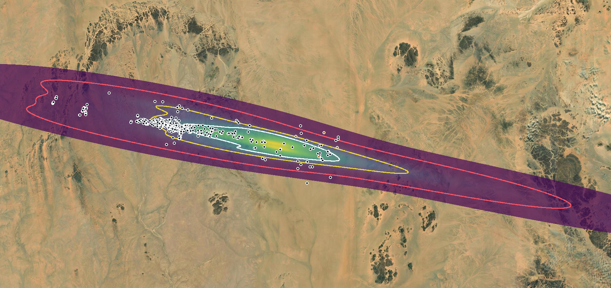
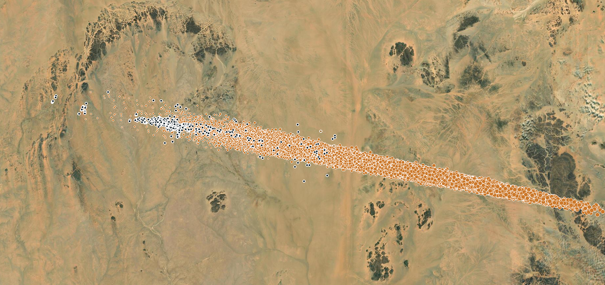
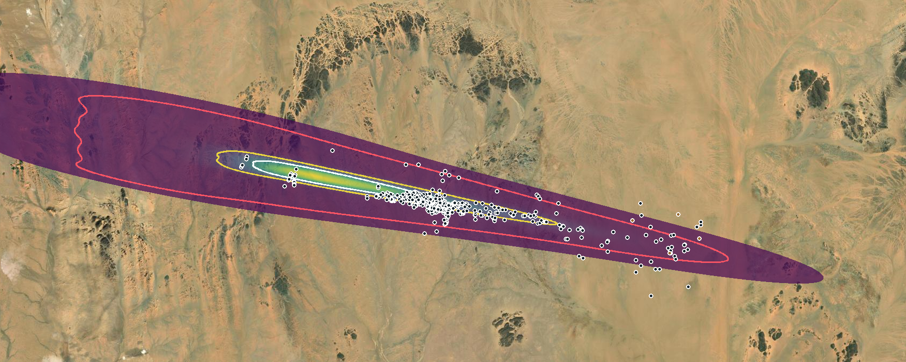
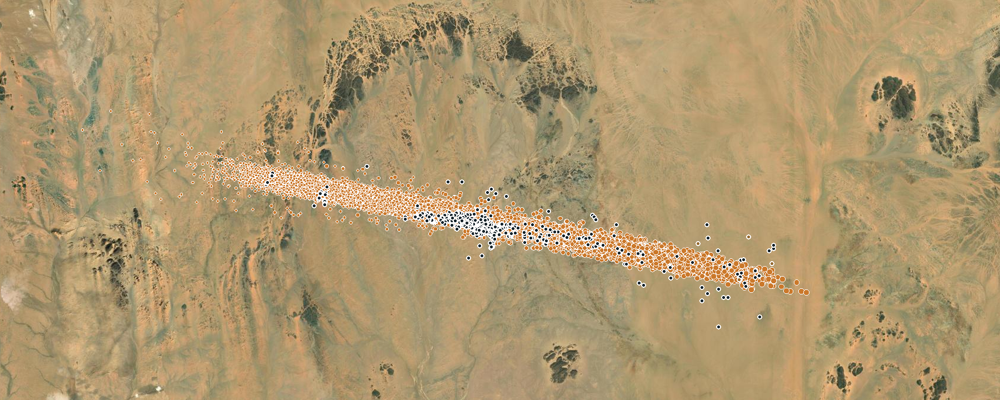
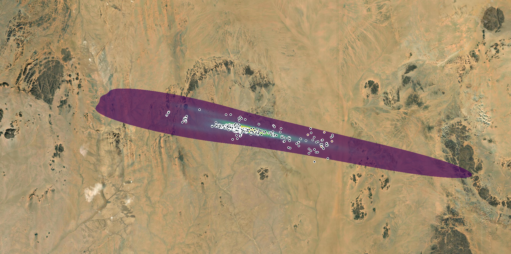
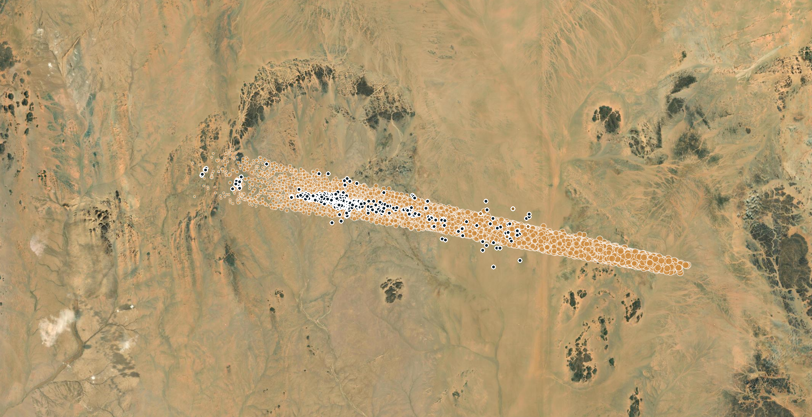

This preliminary case compares Trajecta atmospheric Monte Carlo runs with
published Almahata Sitta meteorite recoveries. It includes an orbital-MC
baseline and fixed-entry runs with different material assumptions.

## Run and nominal approach

The fitted solution used 876 of 883 observations, without a non-gravitational
model. A covariance Monte Carlo generated 5,000 entry states at the 100 km Earth
boundary; all 5,000 crossed it. The atmospheric run sampled these states and
finished 650 of the requested 1,000 realizations under its convergence rule,
with 49,716 tracked impact representatives and no reported failures or
truncations. The seed was 42.

The fit's nominal 50 km crossing is 20.84934° N, 31.79825° E. For comparison,
[Shaddad et al. (2010), Table 1](https://onlinelibrary.wiley.com/doi/10.1111/j.1945-5100.2010.01116.x)
give 20.85787° N, 31.80381° E for a trajectory based on JPL solution 15. These
positions are approximately 1.1 km apart horizontally. These are separately
determined solutions; the published track neglects atmospheric deceleration.

## Material assumptions

The run used the ordinary-chondrite preset: density 2,500–3,500 kg/m³,
strength 0.9–5 MPa and ablation coefficient 7–9 × 10⁻⁸ kg/J. Initial size was
sampled from H = 30.311 and an albedo range of 0.075–0.33; this is an assumed
distribution, not a direct measurement of the asteroid's initial mass.
Wind and drag multipliers were each sampled from 0.85–1.15. The archived run
used automatic environment data and a 1 g minimum modeled fragment mass.

Almahata Sitta contains multiple lithologies, largely ureilitic material.
A single ordinary-chondrite preset therefore only approximates the body.
Published estimates of its pre-entry mass also vary substantially.

## Fragmentation

The archive records 1,979 breakup events, including one initial-body breakup
in each of 650 realizations. Their median first-breakup height is 28.84 km
(range 24.50–37.19 km), and median assigned strength is 3.05 MPa.

By contrast, [Shaddad et al. (2010)](https://onlinelibrary.wiley.com/doi/10.1111/j.1945-5100.2010.01116.x)
describe initial disruption at about 46–42 km. Later fragmentation also occurred;
the first model breakup should not be equated with the brightest flare. The
default run does not reproduce that reported early fragmentation. A closer
comparison requires specifying the pressure convention and atmospheric model,
not merely matching heights by adjusting the strength.

## Published recoveries and modeled field

The [coordinates used here](/Trajecta/docs/data/2008-tc3-recoveries.csv) comprise
575 identifiable rows transcribed from Tables 2–3 of Shaddad et al. and seven
additional numbered recoveries from the tables of [Jenniskens et al. (2022)](https://onlinelibrary.wiley.com/doi/full/10.1111/maps.13892).
They are an incomplete subset of the recovered meteorites. Four entries have
explicitly uncertain or approximate positions; possible pairing, unverified
finds and selective search coverage remain in the other entries. Multiple
finds at one location are not necessarily independent events.

Published recoveries are shown as dark circles with white outlines; ochre
circles mark locations explicitly identified as uncertain or approximate.
The white, yellow and red lines are the modeled 50%, 80% and 99%
number-weighted density contours. The image was rendered from the saved
simulation grid, contours, cached imagery and published coordinates; it is
not a screenshot from the original article.

Dark circles represent published recoveries; orange circles show the 28,512
simulated impact representatives included in the report's map preview, not
all 49,716 tracked representatives. Their marker sizes reflect modeled mass,
and their plotted counts do not account visually for multiplicity. Basemap
imagery: Esri, Vantor, Earthstar Geographics and the GIS User Community.

Of the 578 unflagged records, 114, 474 and 572 lie inside the respective 50%,
80% and 99% **number-weighted modeled** density contours. The counts describe
this selected recovery dataset, not statistical coverage probabilities: the
search was neither uniform nor independent of earlier trajectory estimates.
The mass-weighted density is a different quantity and must not be interpreted
as a meteorite-number probability.

The unweighted centroid of those recoveries is 20.73425° N, 32.36929° E;
the simulated number-weighted centroid, using representative multiplicities,
is 20.72107° N, 32.44883° E. The latter is about 8.4 km southeast of the former.
The populations were sampled differently: detection and search selection
affect which meteorites are represented among the finds.

The saved map's requested 25 m cells were increased to 50 m by the map generator
to satisfy grid limits. The recorded adaptive-kernel contours, rather than the
underlying raw fragment points, were used for the point-in-contour counts.

## Fixed-entry sensitivity experiment

Two additional runs use the same fixed 100 km entry from [JPL solution 18,
Table 2](https://ntrs.nasa.gov/api/citations/20190000232/downloads/20190000232.pdf):
21.0871° N, 30.5380° E and a ground-relative speed of 12.380399 km/s. The
input heading is 101.0968° in the direction of travel and the flight path
angle is −20.8332°. The UI time was entered as 2008-10-07 02:45:30 UTC;
the publication gives 02:45:30.33. Because these values were used as input,
the atmospheric runs do not independently validate that trajectory.

| Setting or result | Fixed-entry default material | Fixed-entry alternative material |
| --- | ---: | ---: |
| Initial mass | From H = 30.3108 and sampled albedo | 35,000–65,000 kg |
| Density | 2,500–3,500 kg/m³ | 2,000–2,800 kg/m³ |
| Strength, using `ρv²` | 0.9–5 MPa | 0.2–0.3 MPa |
| Atmospheric realizations completed | 650 | 250 |
| Tracked impact representatives | 49,715 | 419,922 |
| Median first-body breakup height | 28.84 km | 46.41 km |
| Unflagged recoveries inside 50% / 80% / 99% number contours | 154 / 487 / 572 | 77 / 333 / 544 |

Both runs requested 1,000 realizations, seed 42, and stopped under the
configured convergence criterion, without reported failures or truncations.
Their entry is fixed, not sampled from the JPL entry covariance. Identical
input entry and weather choice do not make these matched random realizations;
their sample counts and fragmentation histories differ.

The alternative material run used the published 50 ± 15 tonne mass estimate
as a range. Its density is a chosen compromise because the current model uses
one sampled density for both the parent and its fragments. The 0.2–0.3 MPa
threshold was motivated by the reported early disruption; its pressure
convention has not been reconciled with every publication. The resulting
first-breakup height agrees with the reported 46–42 km, but several inputs
changed together, so the contribution of each one remains unclear.

Dark outlined circles are published recoveries; orange circles are the 31,981
simulated representatives in the map preview. Both maps use the saved run's
grid, contours and imagery. Esri, Vantor, Earthstar Geographics and the GIS
User Community provide the basemap imagery. The plotted preview is not the
full sample and marker counts do not reflect fragment multiplicity.

For the alternative run the number-weighted modeled centroid is about 6.9 km
from the unweighted centroid of the 578 unflagged recoveries, to the northwest;
for the fixed-entry default run it is about 7.4 km away, to the southeast.
These compare populations selected in different ways.

For the alternative run, the separation between modeled and observed
centroids is approximately 8.5 km for 1–10 g, 3.1 km for 10–100 g and 5.4 km
for ≥100 g. The observed samples contain 363, 145 and 17 unflagged records,
respectively. These bins combine fragments collected with unequal search
efficiency; the model's 1 g cutoff also excludes the smaller published finds.

## Fixed entry with a stronger material

A further fixed-entry experiment uses the same JPL solution 18 entry described
above, with a mass of 48,000–49,000 kg, density of 2,000–2,100 kg/m³ and
strength of 1.0–1.1 MPa. The strength threshold uses `ρv²`. The remaining
sampled ranges are: ablation 7–9 × 10⁻⁸ kg/J, dust fraction 0–0.9, largest
fragment fraction 0.05–0.4, β 0.4–0.8, and wind and drag multipliers 0.85–1.15.
The Weibull exponent is 0.2 and the minimum fragment mass is 1 g. Seed 42 and
15 workers were used. The 100 km entry is fixed rather than sampled from an
entry covariance.

The calculation stopped at 400 of 1,000 requested realizations under the
configured convergence criterion. It recorded 76,601 impact representatives,
with no reported failures, timeouts or truncations.

The underlying images are screenshots of this Trajecta run. Published recoveries
were overlaid afterwards using their coordinates and the report's saved map tiles;
dark circles with white outlines are unflagged records, and ochre circles mark
explicitly uncertain or approximate locations. Orange circles in the second image
are simulated fragment representatives shown in the report, not the complete
impact sample. Marker overlap can hide individual locations. Basemap imagery:
Esri, Vantor, Earthstar Geographics and the GIS User Community.

| Comparison | Result |
| --- | ---: |
| Unflagged recoveries inside the 50% / 80% / 99% number-weighted contours | 454 / 493 / 564 of 578 |
| Distance between modeled and recovery centroids | ~0.57 km |
| First-body breakup height, median and range | 36.16 km (35.83–36.52 km) |

Contour counts were computed from the archived number-weighted density contours,
not from the screenshots; the screenshots do not display contour lines. The
modeled centroid uses representative multiplicities, while the recovery
centroid weights records equally. The nonuniform search and uncertain recovery
positions limit the interpretation of both comparisons.

The same centroid comparison by fragment mass gives:

| Mass range | Unflagged recoveries | Modeled representatives | Centroid separation |
| --- | ---: | ---: | ---: |
| 1–<10 g | 363 | 10,377 | 2.29 km |
| 10–<100 g | 145 | 22,090 | 1.19 km |
| ≥100 g | 17 | 44,134 | 0.33 km |

Each modeled centroid uses the representative's multiplicity and run weight;
each recovery contributes once. The reported representative counts are not
counts of physical fragments. The three bands contain 525 of the 578
unflagged recovery records: 49 have masses below the model's 1 g cutoff and
four have no recorded mass. The comparison does not correct for detection or
search biases. The ≥100 g sample is small, so its centroid is sensitive to
individual finds. A close overall centroid can still hide differences in
width or mass dependence.

The prepared environment for this stronger-material run records NOAA GFS cycle
**2008-10-07 00:00 UTC**,
forecast lead **3 h**, valid at **03:00 UTC**, 14 min 30 s after the fixed
entry time. The archived source is the [historical 0.5° GFS GRIB file](https://www.ncei.noaa.gov/oa/prod-model/global-forecast-system/access/historical/analysis/200810/20081007/gfsanl_4_20081007_0000_003.grb2).
This is a forecast snapshot, not a claimed reanalysis. The nearest three-hour
snapshot was used without temporal interpolation. The prepared atmospheric
grid uses 0.5° horizontal spacing and 50 m vertical spacing; the simulation
interpolates that grid spatially. In preparation, temperature and horizontal
wind are interpolated linearly between pressure levels and density is
interpolated logarithmically; above the highest level the model transitions
towards the US Standard Atmosphere. The archived terrain is Copernicus DEM
GLO-90 with EGM2008 height conversion.
The archived weather metadata for the fixed-entry default and alternative
material runs also names the same GFS source file and valid time. This does
not by itself establish that their prepared grids are byte-identical.

For context, [Moscati et al.](https://arxiv.org/html/2609.01722#S5.SS2)
report a representative TC3 realization using a 3.6 m diameter, a density of
2,000 kg/m³ and strength of 0.5 MPa with a `½ρv²` breakup criterion. The
equivalent threshold for our `ρv²` convention is 1.0 MPa. Their selected
realization has a main breakup near 42 km; our value is the median *first*
breakup of an ensemble. These are not necessarily the same physical event, and
the other parameter ranges, entry state and sampling also differ. This is not
a direct reproduction of that realization or an independent test of its
reported best-match distance.

The three fixed-entry scenarios produce markedly different breakup heights
and fields. The stronger-material run has the closest overall centroid, but
that alone does not establish how well it reproduces the full distribution
or breakup sequence. Several assumptions changed between runs, so the
differences cannot be attributed to strength alone.

## Sources and limitations

- [Shaddad et al. (2010), recovery and observed approach](https://onlinelibrary.wiley.com/doi/10.1111/j.1945-5100.2010.01116.x).
- [Jenniskens et al. (2022), fragmentation and large-mass recovery sample](https://onlinelibrary.wiley.com/doi/full/10.1111/maps.13892).
- [JPL CNEOS, trajectory and satellite observations](https://cneos.jpl.nasa.gov/news/2008tc3.html).
- [ESA NEO, 2008 TC3 impactor](https://neo.ssa.esa.int/past-impactors/2008tc3).

Further work is needed to assess sensitivity to atmospheric and fragmentation
assumptions and to improve the quality assessment of published recovery
coordinates. The comparisons remain retrospective and do not establish
calibrated recovery probabilities or the predictive accuracy of the complete
trajectory-to-ground pipeline.
