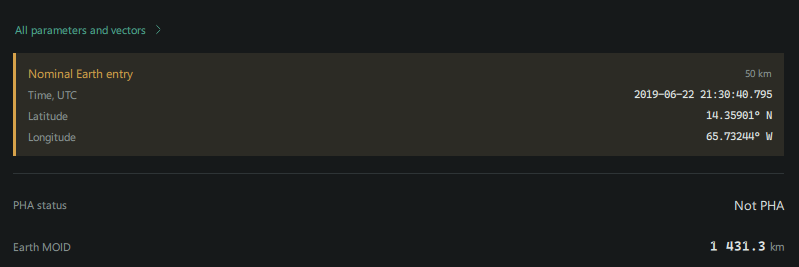
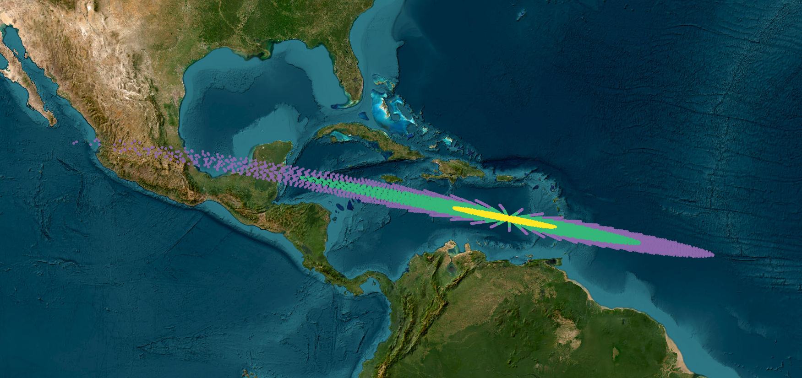

This case compares a saved Trajecta Manifold of Variations (MOV) run for
2019 MO with [Del Vigna, Dimare and Bracali Cioci (2021)](https://doi.org/10.1007/s10569-021-10024-w),
Figures 9–10, and the JPL fireball position reproduced in their Table 1. The
article does not provide the underlying MOV point set or a complete run
configuration, so the visual comparison uses the published figure.

## Nominal entry after the fit

A separate Trajecta fit selected all seven observations. Its nominal
trajectory crossed the **50 km WGS84 boundary** at the following point:

| Quantity | Nominal result |
| --- | ---: |
| Time, UTC | 2019-06-22 21:30:40.795 |
| Latitude | 14.35901° N |
| Longitude | 65.73244° W |

This is the fitted nominal orbit propagated to 50 km, without atmospheric
deceleration or fragmentation. The 25 km and surface MOV cases below use
separate calculations; their fit settings have not been matched to this one.
The time is about 4 minutes 53 seconds later than the reported peak
brightness; the two events occur at different altitudes.

The post-fit search is limited to near-Earth candidates and a short future
interval from the solution epoch. If no entry is displayed, that alone does
not establish that no impact is possible. The displayed values agree with
the local fit summary; the complete configuration, loaded data versions and
build revision for this particular fit have not been pinned.

## Trajecta run

The input file `data/examples/NEO/impacts/2019_MO.txt` contains seven optical
observations: three at F52 and four at T08. The saved result contains the same
station codes and RA/Dec in the same order; the epoch offsets are consistent
with UTC-to-TDB conversion to within a few milliseconds. Other input fields
have not been checked field by field. Their saved angular uncertainties
are 0.2 arcsec per coordinate for F52 and 0.8 arcsec for T08; the stored weight
profile is VFCC17 and observer-supplied sigmas are enabled.

The run used RA15, Earth as target, a **25 km WGS84 boundary**, cobweb sampling
with 80 angular positions and 80 radial steps, and a maximum χ of 5. The
archive records SB441 enabled, but does not establish which asteroid kernel
was loaded. This archived run used IAU 1976/1980 and UT1/GAST for Earth-fixed
coordinates; polar motion was not applied. Current versions use Earth PCK when
available. The archive records no warnings.

| Quantity | Saved result |
| --- | ---: |
| Sampled nodes, including centre | 6,401 |
| Nodes with a 25 km crossing | 4,655 |
| Crossing nodes with positive weight | 4,654 |
| Conditional weighted crossing probability | 0.9999692 |

The weighted probability is conditional on the sampled χ/H domain and
successful constrained fits. The 25 km boundary matches the reported
fireball altitude; orbital propagation does not model fragmentation.

The outlined dot marks the JPL fireball position (14.9° N, 66.2° W), reported
to 0.1°. Its position on this image is calibrated against the report's map
grid, not against the plotted MOV points. The screenshot shows the Trajecta run,
with colours grouping points by χ.
These are individual sampled crossings, not a density map. Basemap imagery:
Esri, Vantor, Earthstar Geographics and the GIS User Community.

## Surface comparison with OrbFit

A separate experiment used a nominal **0 km Earth boundary**, not the 25 km
boundary in the figure above. Trajecta MOV used a cobweb with 80 directions
and 80 radial steps, χ ≤ 5 and H ≤ 34.5. It recorded 4,632 crossings including
the zero-weight central point. Its conditional weighted crossing probability
was 0.99995175. Trajecta also performed 10,000 observation Monte Carlo trials:
9,999 crossed the boundary, one did not, and there were no reported fit or
propagation failures. The empirical crossing fraction was 0.9999; this is not
an exact probability of impact.

The independent calculation used an OrbFit MOV cobweb with 80 directions and
80 radial steps, χ ≤ 5 and H ≤ 34.5. Its report listed 4,765 accepted nodes,
4,598 classified as impacting and an impact probability rounded to `1.000`.
This is a weighted MOV probability; the report rounds it to three decimals.
Both calculations use cobweb sampling, with different implementations and
inputs.

The runs used the seven observations described above and DE440 planetary
ephemerides. The MOV archive records SB441 enabled but does not prove the
kernel was loaded. The Trajecta CLI MC used SB441-N16, confirmed loaded;
OrbFit used
16 massive asteroids from its AST17 ephemeris file, excluding Pluto. The 16
asteroid IDs match, but the ephemerides and masses are not identical. For
OrbFit, the uncertainties
were imported from Trajecta's RWO output: 0.201/0.200 arcsec for F52 and
0.800/0.800 arcsec for T08, rounded to the precision of that file.

This OrbFit run is **not an unmodified reference run**: in a separate local
copy, the selected nominal covariance was explicitly passed to the MOV
sampling, and diagnostic output was added for surface coordinates. In the
tested interactive path, the unmodified executable did not pass that
covariance and produced a different sampling. The modified copy reported
OrbFit version 5.0.7. The standard installation was not changed.

For each coordinate, the following table compares marginal weighted MOV
quantiles among recorded crossings with empirical quantiles among the Trajecta
MC crossings. These are descriptive quantiles, not 2D confidence contours.
Longitudes are positive east, and time is MJD in TDT for OrbFit and TDB for
Trajecta; their small difference has not been corrected in this table.

| Quantity | Trajecta MOV 2.5% / median / 97.5% | OrbFit MOV 2.5% / median / 97.5% | Trajecta MC 2.5% / median / 97.5% |
| --- | --- | --- | --- |
| Latitude, deg | 12.957 / 14.631 / 16.871 | 12.985 / 14.667 / 16.908 | 13.000 / 14.633 / 16.796 |
| Longitude, deg | −78.040 / −66.480 / −57.732 | −78.268 / −66.677 / −57.803 | −77.687 / −66.488 / −57.744 |
| Crossing epoch, MJD | 58656.892046 / 58656.897185 / 58656.902505 | 58656.892073 / 58656.897241 / 58656.902557 | 58656.892057 / 58656.897222 / 58656.902530 |

The central MOV nodes give 14.636549° N, 66.510518° W in Trajecta and
14.636563° N, 66.510948° W in OrbFit, about 46 m apart on a sphere. Their
recorded epochs differ by approximately 11 ms without correcting TDT against
TDB. The 46 m separation describes only these two central nodes, not the
accuracy or agreement of the whole MOV. This comparison also includes the
boundary and reference-frame differences described below.

The maximum difference between the marginal cumulative distributions for
Trajecta MOV and OrbFit MOV is approximately 0.0140 in latitude, 0.0135 in
longitude and 0.0070 in time. Between Trajecta MOV and observation MC it is
0.0101, 0.0104 and 0.0107 respectively. The diagnostic export recorded 4,597
surface crossings,
including the zero-weight central node; this differs by one from OrbFit's
4,598 MTP impact classifications. Matching the two files by cobweb indices
identifies the unmatched MTP classification as node **(59, 58)**, with
χ ≈ 4.70147 and ξ² + ζ² ≈ 0.99917 using the rounded MTP output. The diagnostic
export wrote a crossing only when the stored surface time changed and the
target was Earth. The missing row therefore does not on its own establish
whether the orbit missed the ellipsoid or the diagnostic condition failed.
All 4,597 exported crossings matched MTP impact classifications. OrbFit's
exported coordinates evaluated against WGS84 were approximately 15–22 m below
the ellipsoid despite its nominal 0 km surface, so the two boundaries have not
been shown to coincide exactly. In the inspected OrbFit source, MTP impact
classification and surface-crossing detection are separate computations;
the surface calculation uses WGS84 ellipsoid parameters but describes its
equatorial transformation as an approximation. Whether that approximation or
another difference explains the observed offsets and the one-node count
discrepancy remains to be established for the diagnostic run.

Trajecta MC used seed 42, RA15, all seven observations, no sigma clipping,
the VFCC17 weight profile and the 2018 debias table. The interval was
MJD 58656.425430374584 to 58658.425430373936 TDB. The archive SHA-256 is
`7e3ab677d7ad033272ddee9328a6d53072a83565667f6286c8fd7be8d394460e`;
the OrbFit diagnostic crossing file SHA-256 is
`287cb4c425f46c643ee773047da918068b8c12eb9bf647e43680f606b02d04ae`.
The Trajecta MOV result SHA-256 is
`4cab6652729e7cc3ed0349686ff0db8240aecf26a84c66abe89d6ec0bcbb25c3`.
The runs use similar, but not identical, models.

## Comparison with the article

The paper propagates MOV orbits with χ < 5 to 25 km and compares them with
semilinear boundaries and 10,000 observational Monte Carlo samples. Its
Figure 10 shows a long northwest-to-southeast region, as does this Trajecta
run. For our crossing nodes, the coordinate extrema are approximately
**107.8° W to 46.5° W**, and **10.9° N to 21.7° N**. These are extrema of
sampled nodes, not uncertainty bounds or a published result from the paper.

The plot in the article has a broadly similar extent. Its numerical points
were unavailable for a quantitative boundary comparison. The coloured
Trajecta nodes differ from the paper's 1σ, 3σ and 5σ semilinear curves and
are weighted MOV nodes, not equally likely MC clones.

## Comparison with the reported fireball

Table 1 of the article reproduces the JPL fireball report at **2019-06-22
21:25:48 UTC**, **14.9° N, 66.2° W**, and **25 km**. The coordinates are
reported to 0.1°; that rounding alone corresponds to several kilometres.
The reported position and time are for the peak-brightness event, not a
meteorite recovered on the ground.

| Quantity | Central MOV node | Nearest sampled crossing to reported position |
| --- | ---: | ---: |
| Latitude | 14.49698° N | 14.85825° N |
| Longitude | 66.11822° W | 66.27333° W |
| Approximate spherical distance to reported position | 45.7 km | 9.1 km |
| Approximate crossing time, UTC | 21:30:44 | 21:26:38 |
| χ | 0.00 | 1.48 |

The central node is the cobweb centre after its constrained MOV fit; it is
not a weighted mean of crossings. The nearest sampled point was selected by
position after the fact, not by time or probability. Distances use a 6,371 km
reference sphere for a transparent descriptive comparison; input coordinate
rounding, atmospheric effects and observation uncertainty are not included.
Times are converted approximately from MJD TDB using TDB−UTC ≈ 69.184 s;
the central node is about **4 min 56 s later** than the reported brightness
peak. A boundary-crossing time and a fireball peak are not identical physical
observables, so these differences are not formal residuals or validation
thresholds. No independent estimate of the event's uncertainty is established
here.

## Reproducibility and outstanding checks

- Input file SHA-256:
  `98375e389c8834e4532dfbfaf0151f789c9be97fe5278db70b0f44b3454db1c2`.
- Saved result SHA-256:
  `02d587b9b7fd19c7e03986b42fdcd53194642b6f7a2a907146336af388549a93`.
- The seven station codes, RA/Dec and UTC/TDB epochs were checked against
  the saved result. A complete field-by-field match and the article's exact
  observation selection have not been independently established.
- The article does not state the complete weighting, force-model and grid
  settings needed to reproduce its specific 2019 MO figure. The plotted
  MOV coordinates have not been obtained as a numerical reference dataset.
- Grid-density convergence, model sensitivity and the impact of the omitted
  polar-motion correction have not been quantified for this case.
- The build had uncommitted changes and the 25 km MOV boundary was a temporary
  UI configuration. The complete binary, kernel and source revision provenance
  was not pinned, which limits independent reproduction.

This comparison demonstrates quantitative agreement between Trajecta and OrbFit
MOV results under similar modelling assumptions, as well as broad consistency
with the published impact corridor. It does not independently establish the
calibration of impact probabilities, the accuracy of semilinear boundaries, or
the predictive accuracy of the complete pipeline.
