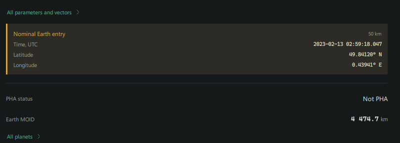
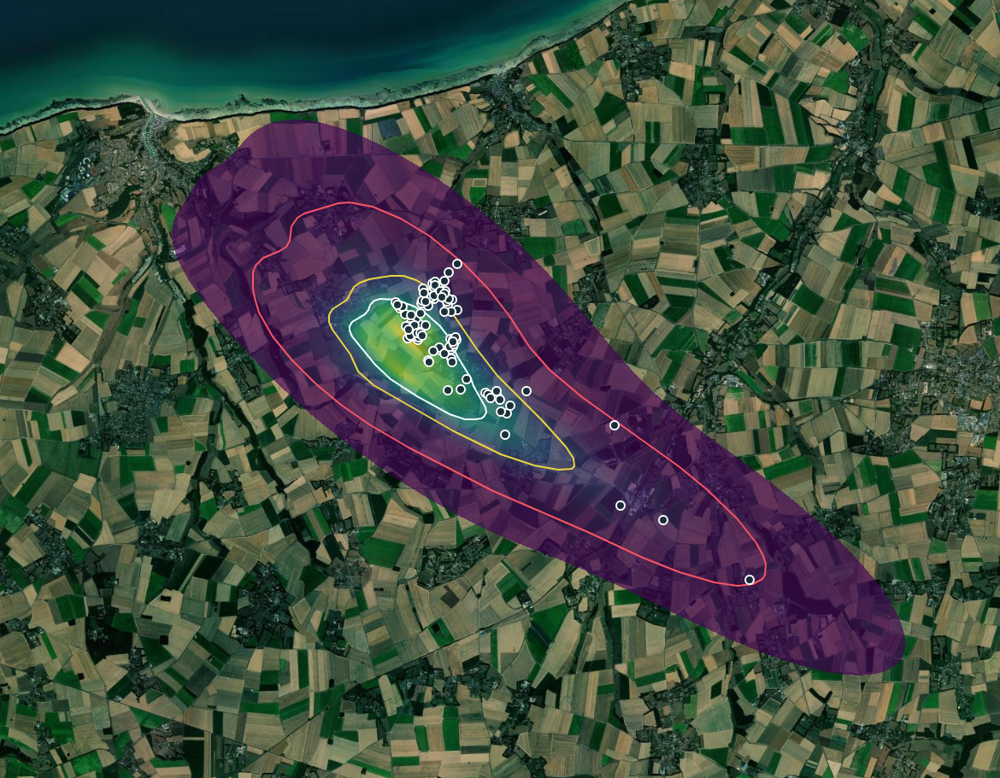
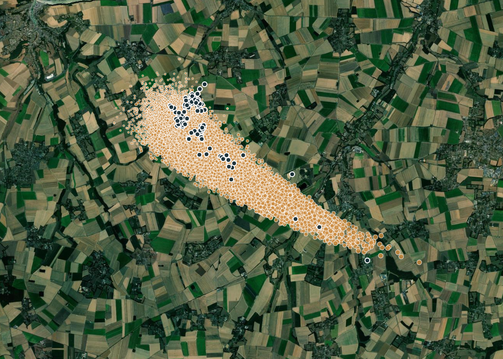

This case compares a Trajecta orbit fit and covariance Monte Carlo with
published ESA Aegis results and a state from JPL Horizons, then examines two
atmospheric Monte Carlo scenarios against reported fragmentation and meteorite
recoveries.

The two references are used differently: the Aegis comparison uses separately
fitted solutions, while the Horizons comparison transforms a JPL state using
Trajecta's Earth-fixed conversion. The fitted orbits and input data differ.

## Scope of the comparisons

| Scenario | Input | What it checks | Main limitation |
| --- | --- | --- | --- |
| Fixed ESA entry | Published Aegis entry at 100 km, with sampled mass and density | Atmospheric propagation, fragmentation and recovered-fragment distribution | Conditional on the entry and assumed physical parameters; not an independent test of the orbit |
| Trajecta orbital MC to atmosphere | Trajecta fit and sampled 100 km entry states | The combined orbit, entry and atmospheric chain | A discrepancy cannot by itself identify the stage responsible |
| Orbital cross-check | Separate Trajecta fit and ESA/JPL solutions | Agreement of selected nominal entry quantities | Inputs and models differ; the JPL result also uses a common Trajecta frame conversion |

The fixed-entry run with **600–700 kg** initial mass and **3,200–3,400 kg/m³**
density is the primary atmospheric comparison below. The earlier orbital-MC
run is retained as the end-to-end case; the earlier fixed-entry run is a
sensitivity comparison. No run is chosen on the basis of which best matches
the recovered fragments.

| Quantity | Role in this comparison | Reference or qualification |
| --- | --- | --- |
| Entry position, speed, direction and time | Input for the fixed-entry run | [ESA Aegis, Table 5](https://arxiv.org/html/2410.15823); it cannot also independently validate that input |
| Mass and density | Ranges selected using published information | [Egal et al.](https://arxiv.org/html/2509.12362) report 650 ± 160 kg and use 3,300 kg/m³ in their modelling; 600–700 kg is a narrower chosen range, not the reported uncertainty |
| Breakup heights | Retrospective comparison | Optical episodes are not automatically identical to model representative-particle breakups |
| Recovered fragment positions and masses | Retrospective comparison with modeled distributions | Search coverage and detectability bias the sample; some physical constraints use information from recovered meteorites |

The fixed-entry calculation is conditioned on a single rounded entry state:
the UI input uses whole seconds and does not sample the published entry-state
uncertainty. Numerical acceptance thresholds have not yet been established.

## Trajecta calculation

The calculation used 258 optical observations of 2023 CX1 (Sar2667), of which
235 were selected for the final fit. The snapshot identifies the weighting
profile as `vfcc17`; the normalized astrometric RMS was 0.522848. The selected
set excluded the last three D03 records. These are not known to be the same
observations rejected in the ESA solution.

The fit used no non-gravitational acceleration. The archived covariance Monte
Carlo propagated 5,000 samples with RA15, seed 42 and 15 workers. All 5,000
completed and crossed the 100 km Earth boundary; no fit or propagation errors
were reported. The archive records SB441 as enabled, but that flag alone does
not establish which asteroid ephemeris file was actually loaded.

The boundary is the WGS84 reference ellipsoid plus the specified altitude.
This archived result used IAU 1976/1980 with UT1/GAST for the Earth-fixed frame;
polar motion was not applied. Current versions use Earth PCK when available.
Ground-relative velocity includes Earth rotation.

## Nominal entry after the fit

A separate Trajecta fit selected 238 of 258 observations. Its nominal orbit
crossed the **50 km WGS84 boundary** at the following point:

| Quantity | Nominal result |
| --- | ---: |
| Time, UTC | 2023-02-13 02:59:18.047 |
| Latitude | 49.84120° N |
| Longitude | 0.43941° E |



This is the fitted nominal orbit propagated to 50 km, without atmospheric
deceleration or fragmentation. The ESA and JPL comparisons below use different
boundary altitudes and fits; the complete settings and observation mask of
this 50 km fit have not been pinned.

The post-fit search is limited to near-Earth candidates and a short future
interval from the solution epoch. Absence of a displayed entry does not by
itself establish that no impact is possible.

## Comparison with ESA Aegis

[Carbognani et al., Table 5](https://arxiv.org/html/2410.15823) gives Aegis
entry parameters at **100 km** above the WGS84 ellipsoid. The table below
compares those values with the nominal trajectory, not the mean of MC samples.
Latitude and longitude use degrees north and east, respectively.

| Parameter | Trajecta | ESA Aegis | Trajecta minus ESA |
| --- | ---: | ---: | ---: |
| Time, UTC, 2023-02-13 | 02:59:13.328 | 02:59:13.387 ± 0.070 s | −0.059 s |
| Latitude | 49.9190211° | 49.919022 ± 0.000120° | approximately −0.1 m north |
| Longitude | −0.1460686° | −0.1467625 ± 0.0006545° | approximately +50.6 m east |
| Ground-relative speed | 14.016709 km/s | 14.016450 ± 0.000185 km/s | +0.259 m/s |
| Downward slope from local horizon | 49.152356° | 49.153055 ± 0.000510° | −0.000699° |

The nominal crossing positions are approximately **50.6 m** apart on the
100 km boundary. The paper used 368 observations, including
subsequent measurements and remeasurements, and reports three rejected
observations. The input sets, selection, weighting and modelling choices
therefore differ.

The MC estimates for this run were approximately 0.086 s for the sample
standard deviation of crossing time and 65.7 m for the major axis of the
sample position covariance ellipse. The paper reports 0.070 s and 95.93 m,
respectively. Different observations and modelling assumptions prevent these
figures from being treated as a controlled covariance comparison.

## Comparison with JPL Horizons

A second run used a temporary 101.755 km boundary. On 2026-11-09, Horizons
returned the current **JPL #14** solution, with DE441 and SB441-N16. At
approximately the same boundary, its geometric Earth-centred J2000 ecliptic
state was converted to Earth-fixed coordinates using Trajecta's conversion.

| Parameter | Trajecta fit | JPL #14 state, Trajecta conversion | Trajecta minus JPL |
| --- | ---: | ---: | ---: |
| Latitude | 49.9216702° | 49.9216398° | approximately +3.4 m north |
| Longitude | −0.1664577° | −0.1670862° | approximately +45.9 m east |
| Ground-relative speed | 14.015519 km/s | 14.015201 km/s | +0.318 m/s |
| Downward slope from local horizon | 49.162415° | 49.163137° | −0.000722° |

The trajectories are separate solutions evaluated at their respective boundary
crossings. Their calculated positions differ by approximately 46 m and their
slopes by 0.00072°. Horizons supplied the JPL state; both columns use the
same Trajecta Earth-fixed velocity and horizon calculation, so this is **not an
independent test of that conversion**. JPL #14 is a combined solution that
also uses an atmospheric entry constraint; it is not an independent orbit
fitted solely to the same optical data as the Trajecta solution.

For traceability, the Horizons state was requested in geometric Earth-centred
J2000 ecliptic coordinates, in km and km/s, at JD 2459988.625259175 TDB.
The state was approximately 0.20 m below the requested boundary after the
Earth-fixed conversion; this small height difference was not interpolated away.
The source is the [JPL Horizons system](https://ssd.jpl.nasa.gov/horizons/);
the solution number must be checked when repeating the query because the
current solution can change.

## Reproducibility and limitations

- The repository's `data/examples/NEO/impacts/2023_CX1.xml` contains 258
  optical records. Their station codes and RA/Dec match the archived input
  snapshot in order; this check alone does not establish that every input
  field or file byte is identical to the original fit input.
- The checked XML has SHA-256
  `1a9a439d1328274bafb93e02ed191e9cf8e483ed4ee344b827896431f229336d`.
  With one-based indices in that file, the archived fit excluded records:

  ```text
  24 29 31 33 42 62 65 69 78 81 86 87 92 102 103 180 195 200 206 211 256 257 258
  ```

- The archive contains the sampled states, selected-observation snapshot,
  covariance, force flags and MC configuration. The complete fit settings,
  loaded-kernel identities and all data-file versions were not captured in
  a portable manifest. The build also contained uncommitted changes.
- The 101.755 km boundary was temporarily configured for this diagnostic; it
  is not a general-purpose selectable altitude in the released UI.
The settings and checksums help trace the calculation, but incomplete build
and input-data provenance limits independent reproduction.

## End-to-end atmospheric comparison

This is a separate exploratory run from the orbital comparisons above. It
uses a fit with **238 of 258** optical observations selected: unlike the
235-observation fit above, the three final D03 observations were included.
The covariance MC propagated 5,000 samples to a 100 km WGS84 boundary, and
all 5,000 crossed it. The atmospheric calculation sampled those entry states.
It did not use a fireball-video trajectory as its initial condition.

Of 1,000 requested atmospheric realizations, 300 completed before the
configured Jensen–Shannon convergence criterion stopped the calculation. All
300 had ground impacts; there were no failed or incomplete realizations. The
archive contains 15,436 representative fragment impacts. Representatives can
stand for multiple fragments, so this is not a count of recovered meteorites.

The initial size was sampled from H = 32.571 and albedo 0.075–0.33 (mode
0.208); density was sampled from 2,500–3,500 kg/m³. The selected strength
range was 0.9–5 MPa. The atmosphere used NOAA GFS 2023-02-13 00 UTC, +3 h,
with a 0.25° grid and no temporal interpolation; terrain used Copernicus
GLO-90 and EGM2008. The job used seed 42, 15 workers, and a 1 g minimum
fragment mass. Other fragmentation, ablation and wind settings are in the
archived job; these ranges are assumptions, not measurements of each fragment.

### Fragmentation cross-check: orbital-MC entry

[Egal et al., tables 2 and 4](https://arxiv.org/html/2509.12362) report a
preferred pre-atmospheric mass of **650 ± 160 kg**, inferred using several
methods. The study identifies two optical fragmentation episodes at
**29.4 ± 0.01 km** at 02:59:20.10 ± 0.04 UTC and **28.1 ± 0.02 km** at
02:59:20.23 ± 0.04 UTC. It associates the peak of the flare with dynamic
pressure of approximately **4 MPa**; this peak is not necessarily identical
to the first fragmentation event. These are retrospective constraints,
including fireball observations: they are used here as reference data, not
as the input trajectory of the Trajecta atmospheric calculation.

The paper's main text gives **27.1 km** for the second episode, whereas its
Table 4 and discussion of individual fragments give **28.1 km**. The
comparisons here use the table value; this inconsistency in the source has
not been resolved with the authors.

The archive records **985 breakup events of representative particles** in
300 realizations: one initial breakup in each realization and 685 subsequent
events. The median is two recorded events per realization, with a range of
1–46. A representative may stand for multiple physical fragments, and multiple
model breakups cannot be counted as one-to-one detections of optical flares.
First-breakup heights span **26.16–37.11 km**, median **30.00 km**. Initial
masses span **528–4,266 kg**, median **1,136 kg**.

As an illustrative retrospective check, realization **134** began at
643.2 kg with density 2,862.9 kg/m³ and a sampled initial breakup strength of
3.246 MPa. Its first breakup occurred at **29.282 km**, about **0.118 km below**
the first reported optical event; its second representative breakup occurred
at **26.304 km**, about **1.796 km below** the second optical event. The
corresponding calculated times were approximately 02:59:19.983 and
02:59:20.294 UTC. Their differences from the reported events are about
−0.117 s and +0.064 s, respectively. The second model event is a fragment
breakup and is not established to be the observed second event. Nominal
height and timing differences do not account for model and input uncertainty.

This realization was chosen after seeing the reference, as an example near
the reported initial mass and first-breakup height, not as an independent
prediction or a verified best physical solution. Its wind scale was 0.917,
drag scale 0.877, ablation coefficient 7.064×10⁻⁸ kg/J, dust fraction 0.309,
largest-fragment fraction 0.257, and mass exponent beta 0.659. The realization
that best matches the selected recovery centroids under a separate, post-hoc
two-bin score is **57**, but it starts at approximately 3,460 kg and matches
only those chosen centroid criteria; it must not be presented as the most
physically accurate realization.

Of the 300 runs, 57 have initial mass within 490–810 kg; 77 have first breakup
within the illustrative window 28.4–30.4 km; 19 meet both conditions. The
1 km height window is an analysis choice, not the reported ±0.01 km measurement
uncertainty. These counts show overlap with the sampled assumptions, not
probabilities of correctness or independent validation.

### Recovery positions and contours: orbital-MC entry

The reference positions are the 100 numbered records in supplementary tables
9 and 10 of [Egal et al.](https://arxiv.org/html/2509.12362). Record 8 was
excluded from spatial statistics: its printed latitude,
49.026883° N, is far from the rest of the field and needs confirmation. It
was not silently corrected. The remaining 99 records have 90 distinct
coordinate pairs; repeated coordinates may represent separate fragments or
duplicate listings, and cannot be resolved from the table alone.

The following two screenshots show the **238-observation orbital-MC entry**
run described above, not the fixed ESA entry with constrained mass and density.



Reported finds are shown as dark circles with white outlines. The white,
yellow and red lines show the 50%, 80% and 99% number-weighted model HPD
contours, respectively. The contours describe the simulated distribution;
they are not confidence bounds on individual recovered meteorites.



The dark circles mark reported finds; the orange circles are representative
simulated fragment impacts. Their number does not equal the predicted number
of meteorites: a representative can stand for multiple fragments. Imagery:
Esri, Vantor, Earthstar Geographics and the GIS User Community.

| Number-weighted model HPD contour | Included recovery records | Distinct coordinate pairs |
| --- | ---: | ---: |
| 50% | 40 / 99 | 40 / 90 |
| 80% | 69 / 99 | 67 / 90 |
| 99% | 99 / 99 | 90 / 90 |

These counts compare the selected finds with the modeled contours. Search
coverage, terrain and detectability affect which meteorites were recovered,
particularly at small masses.

### Displacement by mass

For each interval, the observed centre is the unweighted mean of distinct
reported coordinate pairs within that interval. The model centre is the mean
of impacts in the same mass interval, weighted by `multiplicity × run_weight`.
The table reports **observed centre minus model centre**, projected onto local
east and north at the mean latitude using WGS84. Bins include the lower limit
and exclude the upper limit. Unknown masses, the questionable record 8, and
the 0.84 g record below the 1 g model cutoff are excluded from this table.

| Mass | Finds: records / distinct coordinates | Model representatives / runs | East | North | Separation |
| --- | ---: | ---: | ---: | ---: | ---: |
| 1–5 g | 52 / 49 | 6,791 / 292 | +0.540 km | +0.297 km | 0.616 km |
| 5–20 g | 33 / 32 | 5,168 / 298 | −0.117 km | +0.901 km | 0.908 km |
| 20–100 g | 5 / 5 | 2,885 / 264 | −0.441 km | +0.926 km | 1.026 km |
| 100–500 g | 3 / 3 | 569 / 126 | +0.353 km | −0.452 km | 0.573 km |
| 1–500 g, combined | 93 / 86 | 15,413 / 300 | +0.195 km | +0.541 km | 0.575 km |

The two highest mass bins contain only five and three observed records.
Centres can change with mass-bin boundaries, grouping of repeated
coordinates, model assumptions and search coverage.

### Conditional comparison

The existing 300-run archive was filtered retrospectively, without altering
or rerunning the simulation. Three ensembles were compared against the same
recovered-fragment positions using the centroid method above:

- All 300 realizations.
- The 57 with initial mass between 490 and 810 kg, corresponding to the
  published 650 ± 160 kg estimate.
- The 19 of those 57 with first breakup between 28.4 and 30.4 km. This
  ±1 km window is exploratory, not the reported ±0.01 km measurement error.

| Fragment mass | All 300 | Mass-selected 57 | Mass and height-selected 19 |
| --- | ---: | ---: | ---: |
| 1–5 g | 0.616 km | 0.597 km | 0.544 km |
| 5–20 g | 0.908 km | 0.887 km | 1.044 km |
| 20–100 g | 1.026 km | 0.947 km | 1.081 km |
| 100–500 g | 0.573 km | 0.802 km | 0.904 km |
| 1–500 g combined | 0.575 km | 0.510 km | 0.728 km |

These are distances between observed and modeled centres, not residuals of
individual fragments. Of the 19 mass- and height-selected runs, only six
produced representatives in the 100–500 g bin; only three observed records
lie in that bin. That row is particularly sensitive to finite sampling.

To assess simulation sampling only, 5,000 bootstrap samples were drawn by
resampling complete realizations within each subgroup, retaining all their
representatives and weights. With the observed centres held fixed, the
percentile 95% intervals for the combined 1–500 g centre distance were
**0.511–0.644 km**, **0.390–0.664 km**, and **0.512–1.002 km**, respectively.
These conditional Monte Carlo intervals exclude uncertainty and bias in
meteorite recoveries, search coverage, weather, physical parameters, model
structure and the observational reference. The groups are nested, so these
intervals do not constitute an independent significance test.

Restricting mass did not materially improve every bin, and adding the height
filter did not improve every bin either. The 19-run subset is small. Selection
using post-impact information is a retrospective sensitivity check, not a
blind prediction or proof of calibration. Reference mass and finds are also
not wholly independent: the published mass assessment incorporates
information from recovered samples. This comparison uses centroids only;
the HPD contours above were calculated for all 300 runs and were **not**
recomputed for the subsets.

## Fixed ESA entry: atmospheric comparison

A separate run supplied the [ESA Aegis 100 km entry](https://arxiv.org/html/2410.15823)
directly, rather than sampling the Trajecta orbital covariance: latitude
49.919022° N, longitude −0.1467625° E, Earth-fixed speed 14.01645 km/s,
heading 101.386628° clockwise from north, and slope −49.153055° from the
local horizon. The heading is the direction of motion; the opposite incoming
direction is 281.386628°. The entry was entered as **2023-02-13 02:59:13 UTC**:
the UI accepts only whole seconds, whereas the published value is
02:59:13.387 UTC. The 0.387 s difference must be considered in absolute-time
comparisons of breakup events.

The atmospheric settings and seed 42 were otherwise retained. H was entered
as 32.5706509377 rather than 32.571, resulting in a small change to sampled
initial masses. Both runs used the same GFS 00 UTC +3 h weather snapshot;
their spatial sampling is not asserted to be identical. This fixed-entry
calculation excludes orbital-state uncertainty. It completed 300 of 1,000
requested realizations after the same JS stopping criterion, with 15,440
representative impacts, no failed or truncated runs, and 985 recorded
representative breakup events. First-breakup heights were 26.16–37.11 km,
median 30.00 km.

| Mass of recovered/model fragments | Previous orbital MC entry | Fixed ESA entry |
| --- | ---: | ---: |
| 1–5 g | 0.616 km | 0.671 km |
| 5–20 g | 0.908 km | 0.898 km |
| 20–100 g | 1.026 km | 0.996 km |
| 100–500 g | 0.573 km | 0.617 km |
| 1–500 g combined | 0.575 km | 0.595 km |

Both columns use the centroid method and observational exclusions described
above. For the combined interval the fixed-entry model centre is approximately
66 m west and 7 m north of the preceding model centre. The number-weighted
50%, 80%, and 99% contours contain **39, 69, and 99 of the same 99 recovery
records**, respectively, versus 40, 69, and 99 in the previous run. The
remaining source record is excluded for the suspect latitude described above.
Both runs use the same atmospheric and fragmentation assumptions, but their
inputs differ. The fixed-entry `source.json` SHA-256 is
`71bc447c04c22cdc197ec51a5e61d2d332a6153b48145e1315194b2a631fc611`;
its `impacts.csv` SHA-256 is
`da4d791b1dd2a3801f0725996a17a0c0664a2cec427a242954a6111f2f0fbc84`.

### Primary case: constrained mass and density

A further fixed-entry run used the same ESA entry and seed 42, but sampled
initial mass directly from 600–700 kg and density from 3,200–3,400 kg/m³.
These are ranges, not exact values of 650 kg and 3,300 kg/m³. The previous
fixed-entry run used H and albedo to sample size and a wider density range;
therefore both mass and density assumptions changed together. The remaining
fragmentation ranges and the GFS weather snapshot were retained. Other sampled
parameters include strength 0.9–5 MPa, ablation coefficient
7–9 × 10⁻⁸ kg/J, dust fraction 0–0.9, largest-fragment fraction 0.05–0.4,
and fragment mass exponent 0.4–0.8. The run used Weibull alpha 0.2, a
1 g fragment cutoff and three representatives per fragment bin. Wind and
drag multipliers each ranged from 0.85 to 1.15. These values are modelling
assumptions, not direct measurements of the body or its individual fragments.

The run stopped at the JS convergence criterion after **250 of 1,000**
requested realizations, with 9,601 representative impacts and no failed
or incomplete runs. There were 618 recorded representative breakup events;
the number per realization ranged from 1 to 21, with a median of 1. First
breakup heights ranged from **26.15 to 37.09 km**, with a median of
**30.04 km**. Of 250 first breakups, 61 fell within the exploratory
28.4–30.4 km window; this is not the uncertainty of the published 29.4 km
observation. Representative breakup events are not a one-to-one record of
the observed optical bursts.

| Comparison | Published reference | Fixed-entry model result |
| --- | --- | --- |
| First prominent optical fragmentation | 29.4 ± 0.01 km | First model breakup median 30.04 km; range 26.15–37.09 km |
| Second optical episode | 28.1 ± 0.02 km | No one-to-one model-event association established |
| Peak flare dynamic pressure | Approximately 4 MPa | First-breakup pressure is sampled from 0.9–5 MPa; it is not necessarily the pressure at the optical peak |
| Recovered positions and masses | Supplementary Tables 9 and 10 | Mass-binned centroid distances and contour counts below |

The median is about 0.64 km above the first optical episode, but this is a
descriptive difference between different event definitions, not a deviation
in units of observational sigma. A reliable comparison of the second episode
would require an explicit mapping between model fragmentation and luminosity,
which has not been demonstrated for this run.

| Fragment mass | Previous fixed entry, 300 runs | Mass and density ranges, 250 runs |
| --- | ---: | ---: |
| 1–5 g | 0.671 km | 0.679 km |
| 5–20 g | 0.898 km | 1.014 km |
| 20–100 g | 0.996 km | 1.129 km |
| 100–500 g | 0.617 km | 0.628 km |
| 1–500 g combined | 0.595 km | 0.633 km |

These distances use the same mass-binned, number-weighted centroid method
and the same observed records as above. The 50%, 80% and 99% number-weighted
contours contain **31, 61 and 94 of the 99** retained recovery records,
respectively. The questionable latitude remains excluded; repeated positions
may represent separate fragments. These counts are not a coverage test of
the physical probability distribution, because meteorite searches are not
an unbiased sampling process.

The combined-centroid distance has a conditional 95% bootstrap interval of
0.570–0.701 km when entire realizations are resampled and observed locations
are held fixed. This measures simulation sampling only, not uncertainty in
the meteorite recoveries or the physical and atmospheric models. Different
inputs and stopping counts prevent attributing the changes to mass or density
individually, or declaring one setup more accurate from this comparison alone.

The source archive SHA-256 is
`ccfc8bc0f63b1521e78df06e1dfe1a7c71c5f02aa30bad40a70b01a3c67687f7`;
its `impacts.csv` SHA-256 is
`d29ae2079d98fb46871ecbcccc347fd774d68e84c68296cfd5b760b531bc5403`.

For traceability, the atmospheric source archive has SHA-256
`652bfe141813a59af282311032a21dbe3aaf7ac966350f0f0558a8a1914fbe61`;
the archived `impacts.csv` has SHA-256
`ef9e1456c9b51792b2917c8b42841c04bad4ba2dbdb0904ceb5c5fe20083d357`.
The exact build and complete source data were not pinned.

## Remaining verification work

- Record available source observations, settings, data versions and
  observation masks alongside future comparisons.
- Repeat the fixed-entry case with a fixed realization count and multiple
  seeds; assess sensitivity to mass, density, strength and wind separately.
- Define a defensible correspondence between modeled fragmentation and the
  measured light curve before comparing individual bursts or peak pressure.
- Document how recovery locations were selected and resolve the questionable
  coordinate and repeated positions against their source where possible.
- Establish acceptance criteria before further comparisons and test other
  historical events; these retrospective results do not establish predictive
  accuracy for different meteoroids.
